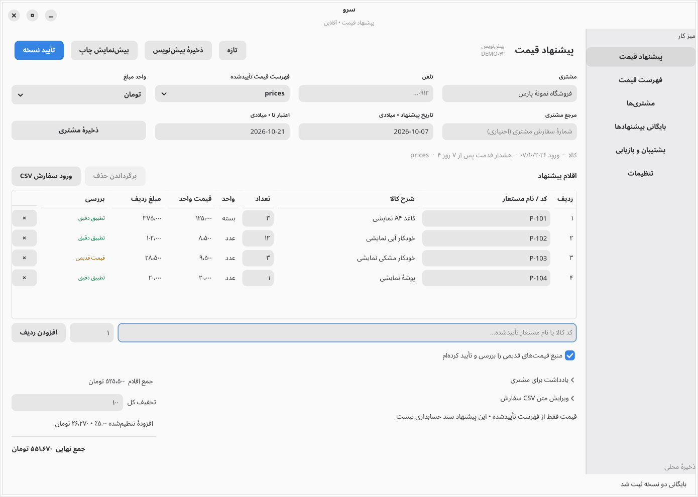
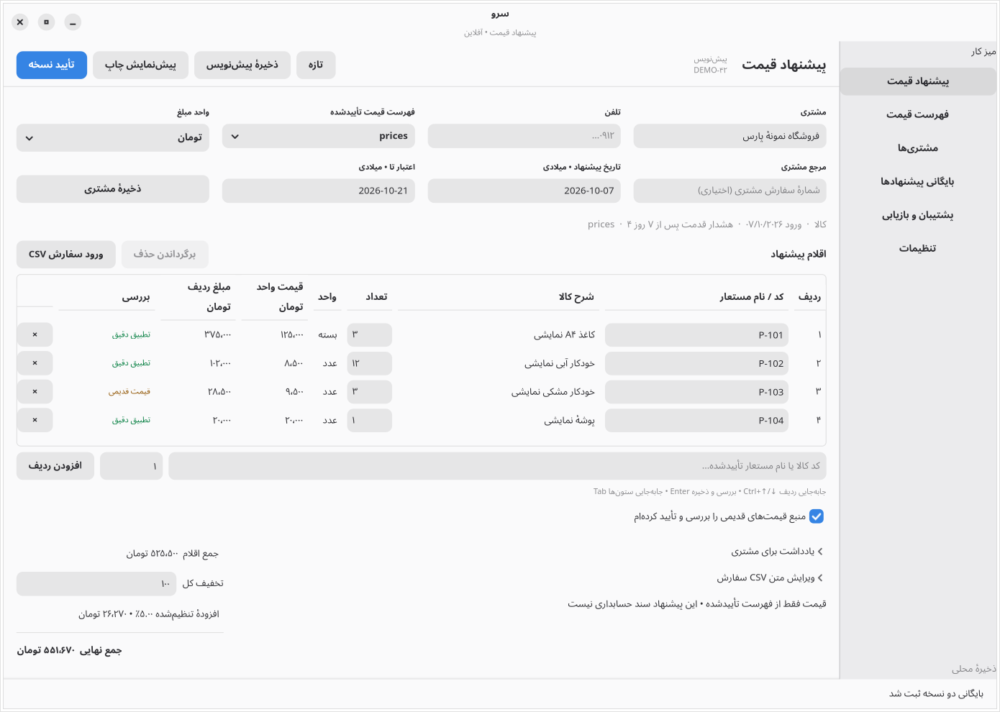

# Native quotation continuation — 2026-10-07

The Persian quotation workflow now keeps its actions fixed above a scrolling document, adapts metadata to narrow windows, and renders at most 100 editable rows per page. Settings expose Save/Revert and validation at the top. Customer creation, catalog search/add, validated imports, immutable quote revisions, export and recovery workflows pass the native acceptance checks below. Existing normal data was not used as a test fixture; all verification used separate synthetic profiles. No deployment or credential changes were made.

The app remains Rust, GTK4 and stable libadwaita. The verified runtime uses Rust 1.99.0, GTK 4.22.5 and libadwaita 1.9.4; the locked Rust libadwaita binding remains 0.9.2 with stable `v1_9` APIs. Seven participants, including the coordinating agent and independent QA, worked with separate editor, management, settings, data/export, responsiveness and QA ownership.

## Interface decisions and rendered comparison

The existing app, source and design/verification documents were inspected first. [Zoho Books](https://www.zoho.com/us/books/help/quote/) informed customer/details → items → notes/totals → approval; [GrandTotal](https://www.mediaatelier.com/en/GrandTotal/) informed a compact desktop document workspace; [Apple layout guidance](https://developer.apple.com/design/human-interface-guidelines/layout) informed alignment and restrained hierarchy. These are interpretations, not claims of feature parity. Native Adwaita supplies control styling, focus, colors and preferences.

Both editor captures show the same synthetic four-item offer and exact total: **5,516,700 rials / 551,670 tomans**. The before capture comes from the starting `c21c4ed` build. The after capture is the verified final binary, not a mockup. Currency appears in the price/amount column headings, monetary values do not wrap, descriptions can use two lines, and keyboard guidance stays secondary. Single-page quotes hide unused pagination controls.

Before:

After:

[Settings before](assets/continuation-before-settings.png) and [settings after](assets/continuation-after-settings.png) show the new top action group and saved/dirty/error feedback. The [700×560 capture](assets/continuation-short-window.png) shows the fixed actions and focused discount after document scrolling; it does not show every field simultaneously. [900×940](assets/continuation-narrow-window.png) shows collapsed navigation. The [page-boundary capture](assets/continuation-paged-focus.png) shows focused row 100 entirely inside the table viewport after real keyboard navigation and save. These images were opened and visually inspected.

## Workflow results

| Workflow | Implemented behavior and verification |
| --- | --- |
| Quote editor | Persian RTL and mixed-script identifiers; exact source selection; invalid values retained; stale-price approval gate; delete/undo; Enter/Ctrl+S preserve focus/caret; Ctrl+↑/↓ crosses pages; hidden rows retained in calculations and persistence. |
| Customer/product/price-list management | Native customer New/Edit/Use and Enter save; multilingual token search, aliases and source provenance; explicit product Add from the selected approved catalog. Prices remain immutable source snapshots; replacing source data creates another validated catalog. [Products](assets/continuation-products.png). |
| Imports | Bounded CSV validation and searchable 100-row preview before catalog approval. Order replacement requires native confirmation, saves a recovery backup, retains customer/history, resets stale acknowledgment and rejects invalid current edits. Cancel preserves the draft. |
| History/export | Approval idempotency and numbering, immutable revisions, revision/copy distinction, archive search/filter and wrapping actions; native preview/zoom, PDF and formula-safe CSV with no overwrite. [History](assets/continuation-history.png), [preview](assets/continuation-approved-preview.png), [PDF](assets/continuation-business-quote.pdf), [CSV](assets/continuation-business-quote.csv). |
| Backups | Versioned checksum and full validation before replacement; current edits saved before safety backup; corrupt/oversized/inconsistent restore rejection; atomic publication and optimistic-writer conflict checks. SIGKILL regressions cover commit/restore/export boundaries; hardware power loss is not established. |
| Settings | Persistent business/address, currency/default discount/addition/expiry, prefix/counter, appearance/density/digits, document header/footer/terms and Gregorian date display. Invalid numbering remains editable without writing. Dirty close supports Save/Discard/Continue. Saved settings survive an actual fresh process. Existing approved snapshots retain their values. |

The calculations still use checked integer rials and quantity thousandths with half-up line rounding. No floating-point money conversion or schema/data migration was introduced. Unchanged saves check the SQLite generation without rewriting the aggregate state; changed saves retain full transactional validation.

## Final checks

All final native runs used release SHA-256 `7ae06aab0d74bf819e79adb547c068a8d6695da88229058dede2ec5cd99915d2`; [build provenance](assets/continuation-build.json) records runtime and profile paths.

| Check | Final result |
| --- | --- |
| Format, strict Clippy, locked offline release build | Passed |
| Ordinary Rust suite | **86 passed, zero failed**, one graphical test excluded. [Log](assets/continuation-final-rust.log) |
| Separate graphical lifecycle regression | **1 passed** under X11 with a session bus. [Log](assets/continuation-final-gtk.log) |
| Native workflow | **50 passed**: [quotation 22](assets/continuation-native-verification.json), [settings 14](assets/continuation-settings-native-verification.json), [preview 3](assets/continuation-preview-native-verification.json), [continuation 11](assets/continuation-polish-native-verification.json). |
| Independent actual interaction | **50 passed** using XTest keys and native AT-SPI controls: Tab/Shift+Tab, Enter, Ctrl+S, Ctrl+Enter, Alt+1…6, typed invalid/corrected settings, customer/product actions, 900×940/900×560/700×560 resizing and paged 1,000-row edits. Final logs contain no GTK warning/critical or panic. [Report](assets/continuation-independent-verification.json) |
| Process restart | Same payload SHA-256 and generation **36**, **3 approved snapshots** retained; independent typed business-settings save also survives fresh restart. [Report](assets/continuation-process-restart-verification.json) |
| Synthetic scale | **7 passed**: all 500 preview pages of 50,000 products, at most 100 widgets/page; 1,000 canonical quote lines over 10 pages; unchanged paging preserves generation. [Report](assets/continuation-native-responsiveness-verification.json) |

The scale PDF completed in **5.264 s**, while real Tab, settings navigation and resize worked. A 20 ms GTK heartbeat recorded **248 ticks** during export, maximum gap **90.13 ms** against a 250 ms busy-export threshold. Unchanged page callbacks took **182–322 ms** (median 227 ms); an edited-page callback took **280 ms** and committed exactly once. Initial/setup activity reached a **614 ms** heartbeat gap. These pauses are disclosed rather than included in a blanket responsiveness claim.

Independent `pdftotext -layout` extracted all **1,000 unique product codes** across **126 PDF pages** and the exact **10,080,250.1 toman = 100,802,501 rial** total. [Independent PDF result](assets/continuation-native-scale-pdf-independent.json). The export raster regression independently checks eight monetary cells after locating actual table rules, avoiding fixed font-dependent coordinates.

## Reproduce and production limits

Run `cargo fmt --all --check`, `cargo clippy --locked --all-targets --offline -- -D warnings`, `cargo test --locked --offline`, and `cargo build --release --locked --offline`. In a graphical session run `cargo test --locked --offline --test qa_invariants -- --ignored`. A fresh disposable profile with `SARV_UI_SMOKE=full SARV_DATA_DIR=/absolute/empty/profile ./target/release/sarv-quote` produces native workflow reports and screenshots. Full smoke refuses populated profiles. `SARV_RESPONSIVENESS=1` similarly requires an empty synthetic profile and uses X11/XTest for its real-key probe.

`scripts/qa-native.py --profile PATH` copies an accepted smoke profile before mutating it. This independent harness currently expects the task runtime at `/workspace/sarv-environment`; use a D-Bus session and its activation script. Runtime launch/check helpers are machine-specific and outside the repository. Normal startup never seeds demo records.

No agreed local workflow remains blocked. This is local synthetic acceptance, not production certification. Aggregate JSON persistence, validation and initial widget creation still run synchronously; fully incremental storage and virtualization remain future work. The scale fixture exercises 1,000 matched lines, not the maximum 10,000-line order or worst-case unknown-product selectors. Physical printing/CUPS, final-build Wayland behavior, other distributions/scaling, real screen-reader navigation, all dark/high-contrast states, hardware power loss, packaging/signing and long-running field use remain untested. Interrupted new-file writes can leave harmless staging files; automatic orphan cleanup is not implemented. Quote approval/export does not send a message or create an accounting/tax posting.
