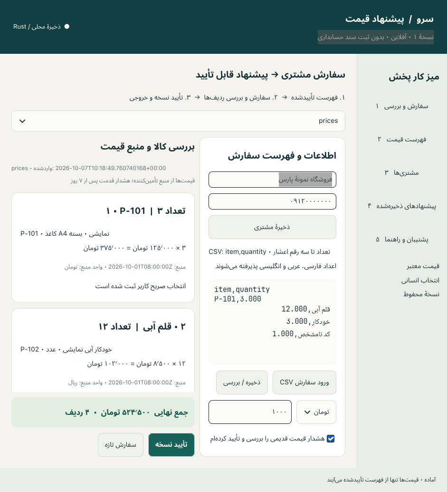
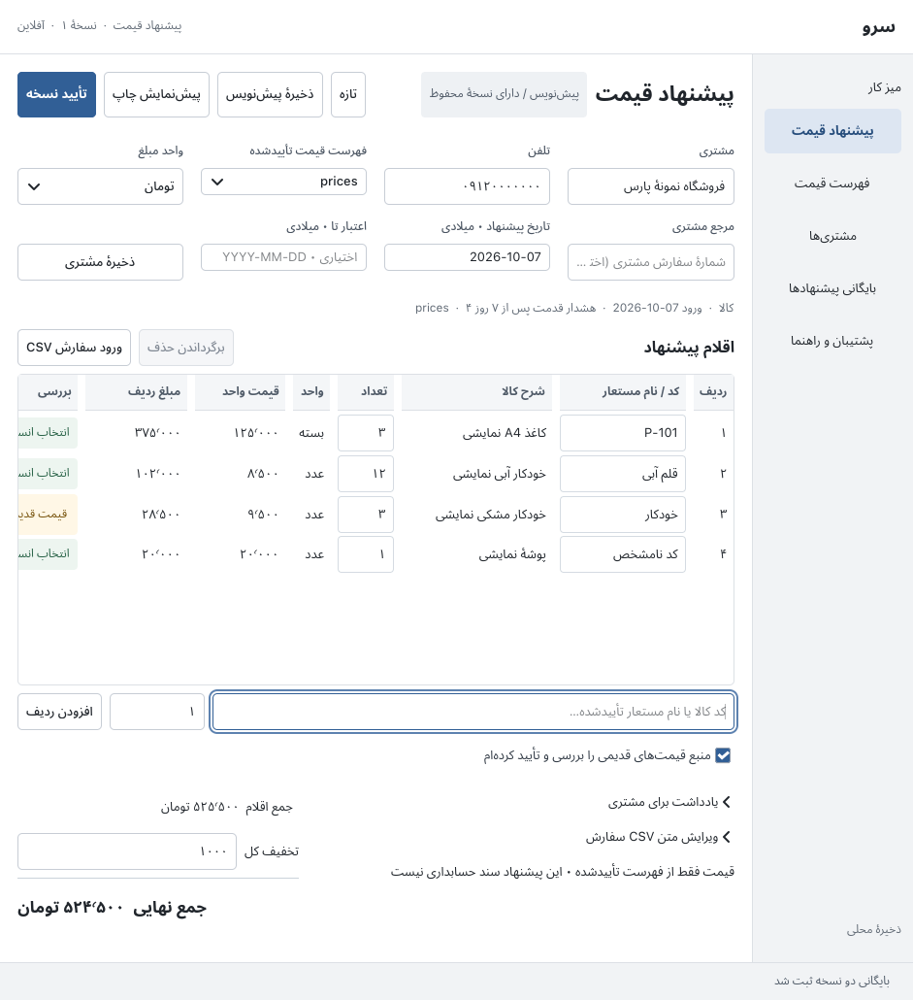
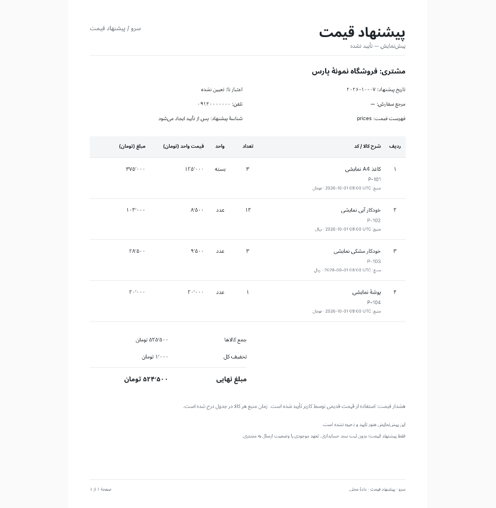
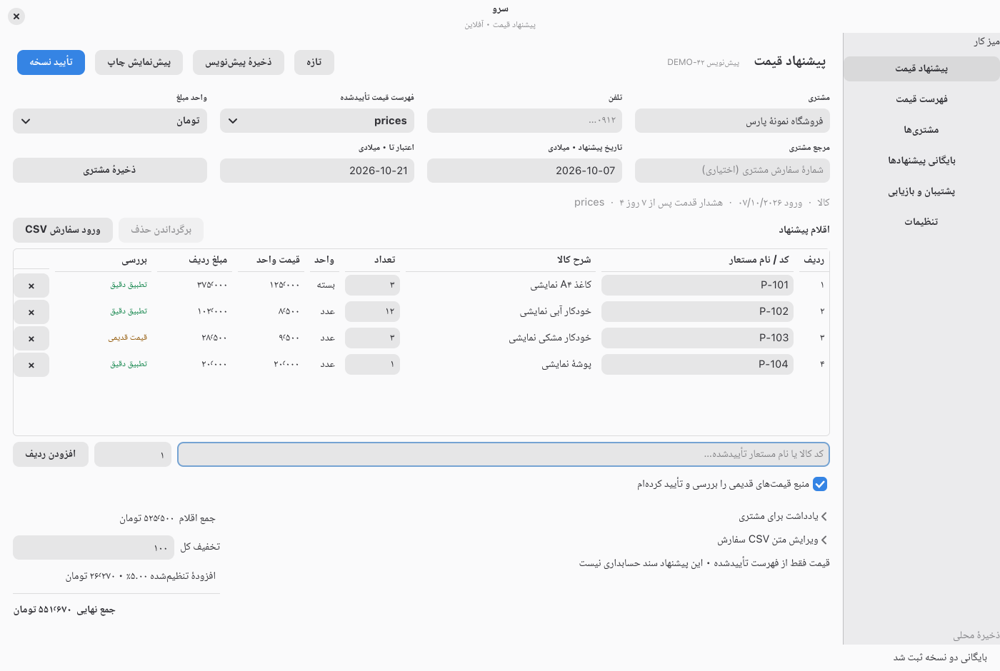
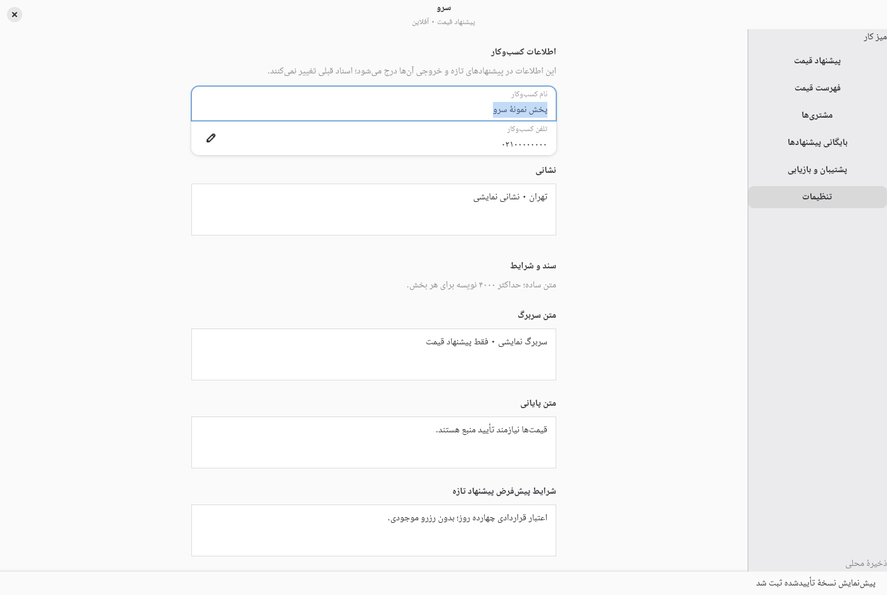
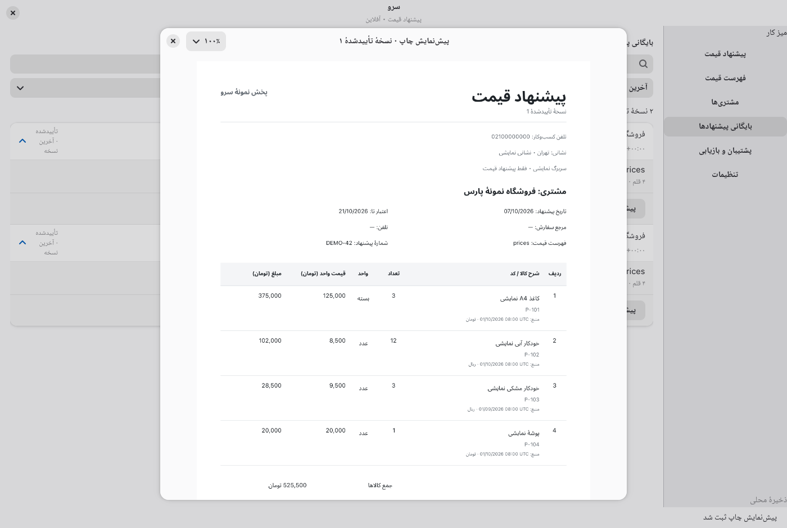
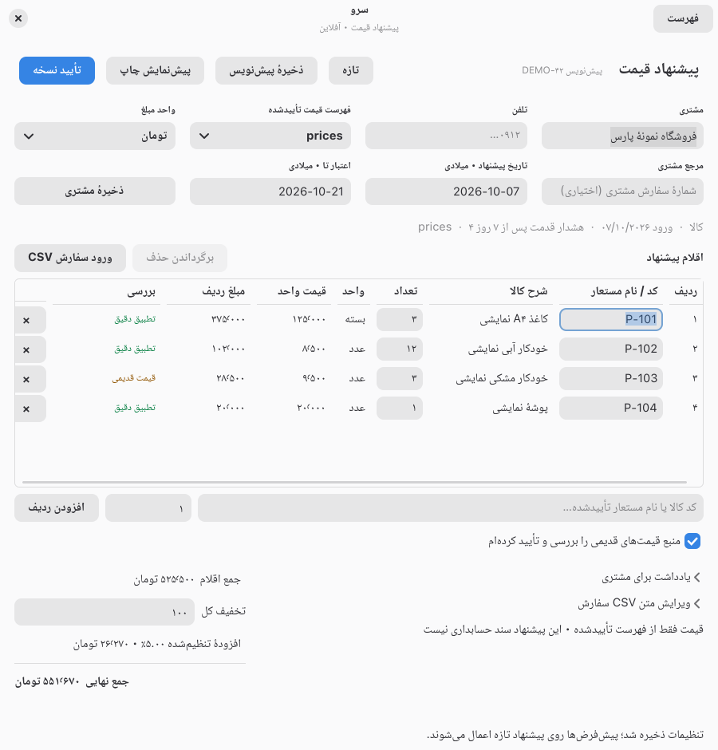

# Native quotation design

Historical milestone record. The GTK, React, and Tauri applications have been removed. Current commands are in [the README](../README.md). Archived source copies are available in Git history; financial migration fixtures remain in this repository.
This is historical verification/design evidence. The current native product delivery, requirements and remaining limits are in [PRODUCT-DELIVERY.md](PRODUCT-DELIVERY.md) and [PRODUCT-ACCEPTANCE.md](PRODUCT-ACCEPTANCE.md).

Current continuation verification and before/after native captures: [CONTINUATION.md](CONTINUATION.md). The results below are retained historical evidence; the continuation report supersedes their outstanding native checks where explicitly tested.

The native screenshots and 39-check GUI acceptance below describe the preceding local v1 build. The current snapshot includes subsequent software-risk fixes; see [SOFTWARE-RISKS.md](SOFTWARE-RISKS.md) for current checks and remaining native verification.
The intended working surface is a Persian quotation document: customer, dates and reference, product rows, notes, totals and one approval action. The product table carries the work. Navigation and decoration should help users finish an accurate offer without distracting from source prices or unresolved requests.

## Reference rationale

Official public references were reviewed on 2026-10-07. They are workflow/style references, not authenticated screenshots of current customer accounts. The current implementation uses native GTK/libadwaita with its own Persian content and business boundaries; no reference branding or paid product is required.

| Reference | Design decision for Sarv |
| --- | --- |
| [Zoho Books quote help](https://www.zoho.com/us/books/help/quote/) | Use a quotation document hierarchy: customer and document details before items; notes and totals after items. Keep creation, revision and export distinct. |
| [GrandTotal official product page](https://www.mediaatelier.com/en/GrandTotal/) | Use a calm desktop document workspace with compact navigation and deliberate printable output. This is inspiration, not a claim of macOS feature parity. |
| [Apple HIG: Layout](https://developer.apple.com/design/human-interface-guidelines/layout) | Maintain clear hierarchy, consistent alignment, restrained spacing and stable placement of related controls. |
| [Apple HIG: Right to left](https://developer.apple.com/design/human-interface-guidelines/right-to-left) | Place navigation and document flow on the right; preserve correct direction for mixed-script codes, timestamps and numbers. |
| [Apple HIG: Lists and tables](https://developer.apple.com/design/human-interface-guidelines/lists-and-tables) | Prefer aligned rows and columns for comparison over repeated oversized cards. |

These decisions are our interpretation of the references. The quotation hierarchy remains useful, while the explicit follow-up direction adopts libadwaita's native components and appearance rather than a hand-styled Apple imitation.

## Current native component foundation

Source inspection confirms `AdwApplication`/`AdwApplicationWindow`, `ToolbarView`, `HeaderBar`/`WindowTitle`, `NavigationSplitView`, native toggle navigation, `AdwDialog` for catalog/restore/print surfaces and `StatusPage` empty states. A 1050 px breakpoint collapses the navigation split to preserve content space; the Persian **فهرست** header control switches between content and navigation. The explicit text avoids relying on a sidebar icon absent in this desktop theme.

The stable Rust binding is `libadwaita` 0.9.2 with `v1_9`, compatible gtk-rs 0.11/GLib 0.22; native libraries installed here are libadwaita 1.9.3 and GTK 4.22.4. Use the [stable 1.9 reference](https://gnome.pages.gitlab.gnome.org/libadwaita/doc/1.9/), whose generated patch documentation can be newer than the installed patch. No 1.11 alpha API is selected. Native libadwaita remains a dynamic LGPL-2.1-or-later system dependency; its Rust bindings are MIT. [README](../README.md) records build requirements and the license boundary.

The current `src/style.css` is 32 lines limited to quotation layout/geometry and semantic native theme variables; the compact setting supplies additional scoped geometry rules. Libadwaita supplies typography, colors, control states, focus treatment and contrast; application CSS does not hardcode RGB values or globally restyle controls. Native preferences and customer/catalog/quote managers are functional. The final quotation, settings, manager and approved-dialog captures below were inspected; behavioral checks are recorded separately in [VERIFICATION.md](VERIFICATION.md).

## Supplied baseline review

The supplied native screenshot [native-baseline-order.png](assets/final-native-native-baseline-order.png) was opened and inspected during this documentation pass. The baseline reports also establish that its native workflow ran. This is a review of that provided screen, not a new interactive accessibility audit.

| Step/surface | Visible finding | Required improvement |
| --- | --- | --- |
| 1. Quotation entry | The tall colored header and large section titles consume space needed for line items. | Compact title/status toolbar and neutral surfaces. |
| 2. Order editing | CSV syntax is the principal entry surface, alongside a narrow fixed form. | Direct editable item rows; keep CSV import available as a secondary path. |
| 3. Item review | Large independent cards prevent rapid comparison; later item rows are below the visible area. | A wide, scrollable table with a shared column header and stable numeric alignment. |
| 4. Approval | Total and approval action are visible, but item provenance competes with card decoration. | Keep totals stable and display unresolved/stale conditions next to the affected rows. |
| 5. Navigation | Persian navigation reads correctly, but decorative spacing and numbered labels create a tutorial-like appearance. | Compact persistent RTL sidebar with current-page state. |

The baseline Persian text visibly joins and reads right to left, while Latin SKU fragments remain legible. Screenshots alone cannot establish keyboard order, screen-reader output, contrast compliance, selection behavior or large-data performance.

## Component contract

- **Typography:** use native libadwaita typography and semantic heading/caption classes, with a Persian-capable font and numeric alignment for comparison. Do not force the earlier proposed font-size scale onto native controls.
- **Spacing:** reserve application-specific geometry for the dense quotation table and document sections; current rows have a 36 px minimum. Long Persian content must wrap or disclose completely without obscuring a price.
- **Surfaces:** inherit native light/dark/system colors, separators and control shapes. No custom RGB palette, emoji, gradients, fake metrics or dashboard cards.
- **Shared controls:** reuse native buttons, labeled entries, dropdowns, table rows, status labels, adaptive dialogs and empty/error states. Persistent labels must explain inputs without relying exclusively on placeholders; native focus behavior must be checked in the actual window.
- **RTL:** GTK/Pango perform Persian shaping. Layout follows Persian reading order; Latin SKUs and timestamps use display-only directional isolation. User-provided bidi overrides/control characters are rejected, not interpreted as layout instructions.
- **State:** “saved” follows successful local persistence. “approved” means an immutable local quote revision. Export never implies sent, accepted, paid or posted status. Invalid and unresolved drafts cannot appear approved.
- **Progressive disclosure:** provenance, warnings and review choices remain close to affected items; import detail and backup replacement confirmation use deliberate secondary surfaces.

The table exposes requested item/code, approved product description, quantity, unit, source unit price and line total. Catalog prices stay read-only: changing quantity or approving an explicit product match never invents a price. The quote discount applies once to the whole quote; an optional user-configured contract-rate addition applies to the net amount with exact integer rounding. This local quote setting is distinct from statutory policy or government submission.

## Earlier GTK redesign evidence

The earlier GTK/Wayland workflow report in redesign-final/native-verification.json (local-only evidence) passed 22 named checks. The provided screen and print-preview captures below were opened and inspected during this pass. They predate the libadwaita/settings/manager/numbering/tax changes and are retained as comparison evidence, not current GUI acceptance.

1. **Document entry — improved:** compact persistent field captions, subdued right navigation and a direct item table replace CSV-first entry. All four requested rows fit in the visible working area.
2. **Item review — improved, narrow-window limit:** aligned quantity, source price and totals support comparison. At the captured approximately 941 px window width, the leftmost review/action columns require horizontal scrolling; use a full-width window to review every column at once. This capture does not establish long-description or large-catalog usability.
3. **Approval and totals — improved:** totals and discount remain together; a contextual approval button stays in the document toolbar. Pending edits, invalid input and changed-source review are separately tested in the native workflow report rather than inferred from appearance.
4. **Print preview — good observed rendering:** Persian shaping, Latin SKU codes, source timestamps, explicit toman units and distinct numeric columns are visible. The document is explicitly a draft preview, without approval or accounting-posting claims.

## Current libadwaita release review

Final release captures from `artifacts/delivery-complete/` were opened and inspected. Separate native reports pass **22 quotation**, **14 settings** and **3 approved-preview** named checks, including no-loss behavior, source review, numbering/addition/issuer snapshots and backup validation. Aggregate Rust and actual injected-key/process-restart evidence is tracked in [VERIFICATION.md](VERIFICATION.md).

| Step | Observed health and evidence limit |
| --- | --- |
| 1. Quotation | At 1400 px the populated screen shows all four item rows and review/delete columns, native selected navigation, persistent Persian captions and distinct explicit totals. Native focus feedback is visible. A narrow table can still scroll horizontally. |
| 2. Products | [Catalog capture](assets/delivery-complete-native-products.png) exposes approved products, aliases, timestamps, stale-source labels and explicit amount units. Product sources remain read-only snapshots. |
| 3. Customers | [Customer capture](assets/delivery-complete-native-customers.png) exposes search and New/Edit/Use actions. The separate settings workflow created a customer through the native dialog and reopened persisted state. |
| 4. Settings | Native preference groups visibly contain business/address/header/footer/terms fields. Lower settings continue below the viewport; the report verifies saved defaults, light appearance, compact density, digit and date choices. This light-theme capture does not establish every dark-mode state. |
| 5. Archive | [Archive capture](assets/delivery-complete-native-quotes.png) exposes latest-revision filtering, saved number/version, preview/export/revise/copy controls and explicit quotation status. No sent or paid status is implied. |
| 6. Approved preview | Native adaptive dialog clearly labels approved version 1 and number DEMO-42. Business text, Latin digits, DD/MM/YYYY Gregorian dates and separated monetary columns render correctly. The document continues below the visible viewport; zoom geometry is verified separately. |
| 7. Narrow quotation | [900×940 px capture](assets/delivery-complete-native-narrow.png) shows the collapsed sidebar, readable **فهرست** navigation button and all item/review/delete columns. A horizontal scrollbar is available. The selected SKU and focus remain visible. |

The former 941 px screenshot demonstrates why the adaptive navigation foundation matters; the current shell collapses navigation at 1050 px and the final 900×940 px state has been inspected. A very short tile around 508 px high cannot contain the main controls; use a tall window (approximately 860 px or more) or maximize. Small-height usability, screen-reader/assistive-technology use, large-order virtualization, physical printing and production field use remain future verification work.
