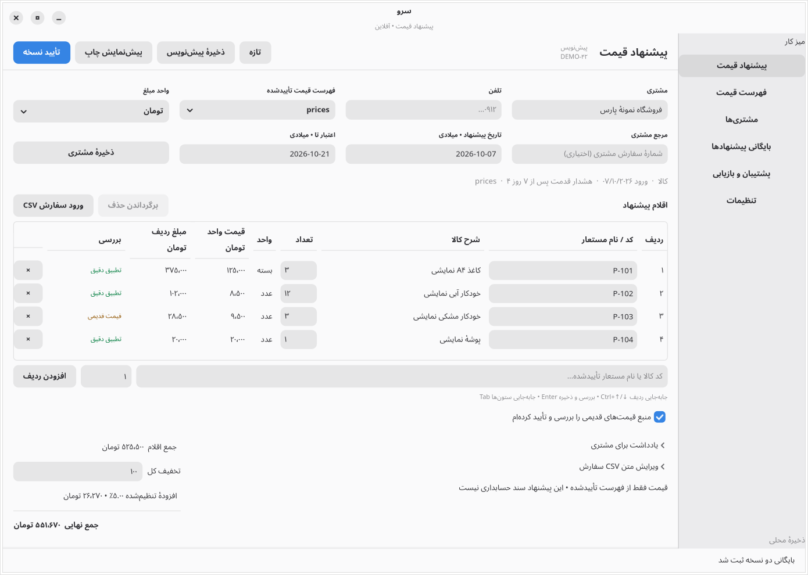
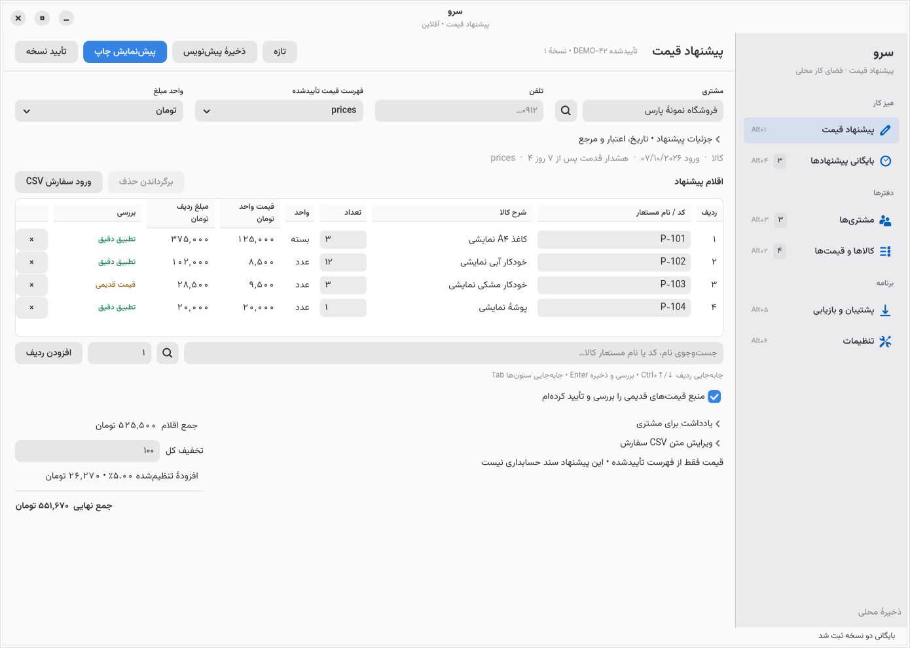

# Native product delivery — 2026-10-07

Historical milestone record. The GTK, React, and Tauri applications have been removed. Current commands are in [the README](../README.md). Archived source copies are available in Git history; financial migration fixtures remain in this repository.

Sarv Quote remains the existing Rust + GTK4 + stable libadwaita application. This cycle improves the actual quotation workspace and adds useful customer/catalog tools; no web rewrite or deployment occurred. Requirements and their evidence are in [PRODUCT-ACCEPTANCE.md](PRODUCT-ACCEPTANCE.md); public research, design decisions and viewing limits are in [PRODUCT-DESIGN.md](PRODUCT-DESIGN.md).

## Concrete changes

The editor has a compact customer/document section, optional metadata, an editable central table, indexed product browsing with exact source prices, customer selection without leaving the document, and a state-appropriate primary action. The sidebar groups daily work, records and data/settings, with native icons, counts and keyboard cues. Bundled Vazirmatn improves Persian UI and PDF typography without installing a system font.

Customer records now include contact, phone, email and address, an ID-linked quotation history, and safe archive/unarchive. Product sources can be composed natively or cloned as a new immutable catalog; CSV is a secondary path with an in-app template, preview and bounded row/column diagnostics. Imports are all-or-nothing. Explicit product selections preserve the requested identifier and exact approved code/price; ambiguous and unknown requests remain a review queue.

The native document preview has page navigation, zoom and deliberate PDF/CSV export of the displayed snapshot. Customer details are included in the document and appended to CSV without changing the existing columns. Four ordinary item rows now fit a readable A4 page. Settings expose the actual data location and backup navigation, alongside persistent business, defaults, numbering, digits, Gregorian dates, appearance, density and document preferences.

Long CSV parsing, candidate validation/serialization, backup/restore preparation and document generation run on workers. Before applying a prepared change, generation checks and current-input guards reject intervening edits rather than overwriting them. Successful restore clears the old draft's Undo buffer. Customer revision preserves known identity after master details change; product search invalidates its row-index cache after reordered catalog restore. Legacy optional fields and old backup checksums remain compatible; financial arithmetic remains checked integer rials and quantity thousandths.

## Rendered comparison and review

Baseline is the freshly run local commit `4a1dbf7`, not an old mockup. All captures below are the actual native app with synthetic data. Final capture/report provenance is recorded in [product-build.json](assets/product-build.json).

| Surface | Before | After and concrete observation |
| --- | --- | --- |
| Quotation | [Baseline editor](assets/product-before-editor.png) | [Final editor](assets/product-after-editor.png): optional details collapsed, customer/product pickers available in place, four rows and totals visible, approved document prioritizes preview. |
| Customers | [Baseline manager](assets/product-before-customers.png) | [Final manager](assets/product-after-customers.png): compact searchable rows; contact/address, history and archive actions disclose on demand. |
| Products/price lists | [Baseline sources](assets/product-before-catalog.png) | [Final sources](assets/product-after-catalog.png): native create/clone, template, explicit source/date/unit/aliases and product search. |
| Quote history | [Baseline archive](assets/product-before-history.png) | [Final archive](assets/product-after-history.png): readable number/customer/date, current editing workspace, approved revisions and deliberate actions; UUID/full timestamps remain secondary. |
| Settings | [Baseline settings](assets/product-before-settings.png) | [Final settings](assets/product-after-settings.png): native grouped preferences, explicit conversion and saved-state feedback; data location/backup access lower on the page. |
| PDF preview | [Baseline preview](assets/product-before-pdf.png) | [Final preview](assets/product-after-pdf.png): readable typography, one-page four-row document, pager/zoom and export actions. |





Additional actual captures: [product picker](assets/product-picker.png), [customer picker](assets/product-customer-picker.png), [native catalog composer](assets/product-catalog-composer.png), [customer-linked history](assets/product-customer-history.png), [dark editor](assets/product-editor-dark.png), [dark settings](assets/product-settings-dark.png), [dark preview](assets/product-preview-dark.png), [900×560 editor](assets/product-narrow.png) and [900×560 totals reached by native wheel scrolling](assets/product-narrow-totals.png). The latter is a supplemental post-approval capture, separate from the fresh28 gallery. The native table scrolls horizontally and the whole document vertically in narrow/short windows; keyboard testing verifies the lower inputs and totals remain reachable. Paged long quotes retain all canonical lines, validation and totals.

The independent reviewer challenged the result beyond passing builds. Material findings were fixed and rechecked: reordered-catalog search returning the wrong row, restore retaining the prior Undo line, obsolete customer duplication during revision, excessive short-table space, unreadable archive metadata, and four-row PDF pagination. Incorrect AT-SPI coordinate/role assumptions and a misaddressed smoke phone field were diagnosed as harness defects and corrected; failed intermediate reports remain in local `artifacts/` rather than being relabeled passed.

## Verification

Final release SHA-256: `31eb8e01e32a6b5129d7abed135de4f3ba08130798b636db30343099017e83ad`. Runtime: Rust 1.99.0, GTK 4.22.5, stable libadwaita 1.9.4. All verification uses disposable synthetic profiles; normal user data and the original running app were left untouched.

| Check against final code/binary | Exact result | Evidence |
| --- | --- | --- |
| `cargo fmt --all --check` | Passed | [build manifest](assets/product-build.json) |
| `cargo clippy --locked --offline --all-targets -- -D warnings` | Passed | [build manifest](assets/product-build.json) |
| `cargo test --locked --offline` | 105 passed,0 failed;2 opt-in tests ignored here and run separately | [complete Rust log](assets/product-final-rust.log) |
| Native lifecycle opt-in test | 1 passed,0 failed | [GTK test log](assets/product-final-gtk-lifecycle.log) |
| Four-row business PDF with bundled actual fonts | 1 passed,0 failed;one A4 page | [font/PDF log](assets/product-final-font-pdf.log) |
| `cargo build --release --locked --offline` | Passed | Final SHA above |
| Native workflow integration | 51 passed:23 quote/data,14 settings,3 preview,11 interaction | [native log](assets/product-final-native.log), [quote/data](assets/product-native-verification.json), [settings](assets/product-settings-native-verification.json), [preview](assets/product-preview-native-verification.json), [interaction](assets/product-polish-native-verification.json) |
| Process restart |3 approved snapshots retained;generation37 and payload hash unchanged | [restart report](assets/product-process-restart-verification.json) |
| Independent real-key checks |50 passed | [independent report](assets/product-independent-verification.json) |
| Independent full new product flow |28 passed,including native dialogs,diagnostics,template,exact-price pickers,approval,revision,history,archive/edit,real file choosers,appearance,narrow navigation and restart | [product report](assets/product-workflow-verification.json) |
| Supplemental post-approval native follow-up |9 passed;resumed synthetic profile,including actual900×560 final-total capture | [supplemental report](assets/product-supplemental-verification.json) |
| Expanded bounded-scale native checks |10 passed | [scale report](assets/product-native-responsiveness-verification.json), [measurement attribution](assets/product-native-scale-attribution.json) |
| Independent scale PDF extraction |92 pages,all1000 unique codes,exact100802501rial | [PDF report](assets/product-native-scale-pdf-independent.json) |

The complete native product fixture selects an aliased product at1251rial, quantity2.375: subtotal2971rial, whole-quote discount1000rial, configured5% addition99rial, final2070rial. Exported contact/address and exact total were inspected in [PDF](assets/product-workflow-preview.pdf) and [CSV](assets/product-workflow-preview.csv). Revision preserves the previous snapshot and customer identity. The separate four-row business fixture remains5516700rial.

| Bounded synthetic operation | Measured final result |
| --- | --- |
|50,000-row CSV parse worker / request-to-completion |128.6 /156.8ms |
|Prepared catalog acceptance, including completion/refresh |477.2ms;final worker-phase GTK heartbeat values are in the scale report |
|Cold / warm indexed picker |141.8 /11.3ms;<=30 native results |
|Indexed exact-last/broad search, including deliberate debounce |274.9 /259.2ms |
|Native composer copy and first100 rows |179.0ms;next page and exact50000th item searchable |
|Catalog preview |All500 pages reached;<=100 rows/page |
|1,000-line unchanged editor page click |165.5 /238.7 /279.3ms minimum/median/maximum;all17 unchanged clicks preserve generation |
|Changed editor page click |326.4ms;the save still synchronously validates/serializes aggregate state |
|1,000-line background PDF |1.775seconds;72 GTK heartbeat ticks,maximum busy gap114.8ms against250ms acceptance threshold |

The global902.9ms heartbeat gap includes native screenshots,actual explicit selection/validation and synthetic fixture restoration in one callback. It is not attributed to the composer or hidden from the result. The report separately records changed fixture save/review423.1ms and restored fixture save338.6ms. These measurements support bounded import/search/export responsiveness; they do not establish that every app operation stays below250ms.

The ordinary Rust suite covers exact rial/toman conversion and half-up rounding, domain/source validation, customer identity/contact/archive, immutable quote/catalog revisions, CSV diagnostics/injection, corrupt and legacy backup handling, no-overwrite file writes, stale generations, process recovery, complete composite product flows and document layout. The graphical lifecycle and actual bundled-font four-row PDF tests run separately because they require isolated native initialization.

## Short demonstration path

1. In **مشتری‌ها**, create a company with contact, phone, email and address. Open its details/history; archive/unarchive preserves its documents.
2. In **کالاها و قیمت‌ها**, create a source natively or import the documented template. Enter explicit currency/source date, code/name/unit/price and approved aliases; inspect preview, then confirm. A clone becomes a new immutable source.
3. In **پیشنهاد قیمت**, press **Ctrl+F** to select the customer and **Ctrl+K** to browse indexed products. Search a Persian name/code/alias, inspect the exact price/unit, choose, enter quantity, and press Enter. Review unknown/ambiguous matches and stale-price warnings explicitly.
4. **Ctrl+S** saves valid edits. Preview the draft; **Ctrl+Enter** approves an immutable local revision. Open the archive to revise or duplicate; previous versions retain original customer/source/calculation snapshots.
5. From preview, export PDF/CSV to a fresh filename. Change settings, save and restart. Create a backup; validated restore shows counts, requires explicit replacement, writes a recovery copy, and clears prior Undo state.

Tab/Shift+Tab traverse native controls; Enter/Space activates; Escape cancels dialogs. Ctrl+↑/↓ moves within an item-table column; Alt+1…6 changes pages. Invalid current inputs block destructive draft replacement and closing until corrected or deliberately reverted. Exactly one active draft persists; earlier displaced drafts are recovery backups, not a multi-draft library.

## Build/run

In this cloud workspace, native libraries/toolchain are staged outside the repository:

```bash
cd /workspace/sarv-quote
source /workspace/sarv-environment/activate.sh
cargo build --release --locked --offline
/workspace/sarv-environment/run-desktop.sh
```

The cloud launcher provides X11/Xvfb/Openbox/Cairo and a D-Bus session. On a regular compatible Linux desktop, install matching GTK4/libadwaita ≥1.9 development packages, Cairo/Pango/Fontconfig, Rust, pkg-config and a C compiler, then run `cargo build --release --locked` and `./target/release/sarv-quote`. [README](../README.md) describes dependency and license requirements. The binary needs system native libraries; this is not a packaged portable release.

Normal storage is `data/sarv.sqlite3`; set `SARV_DATA_DIR=/absolute/path` for a separate profile. Use the app backup command rather than copying a live SQLite file. Do not launch another normal profile under the same desktop application ID while an instance is open.

## Limits and checks still required

Changed draft saves still validate/serialize the aggregate state synchronously; state cloning and final SQLite commit are also synchronous. The bounded measurements disclose these pauses. Incremental storage and fully virtualized editing remain future work; 50,000 products/1,000 lines tested here are synthetic cloud measurements, not a guarantee for every catalog, hardware or 10,000-line document.

Nonfatal GTK focus diagnostics remain in the instrumented product/file-chooser follow-ups: `GtkText did not receive a focus-out event` and `gtk_window_get_focus: GTK_IS_WINDOW` assertions. They caused no observed crash, data mismatch or keyboard failure. A bounded follow-up narrowed accessibility focus queries to the actual control and isolated writable recent-file storage;the focus assertions persisted. Caller attribution is unresolved;[independent review](assets/product-independent-review.json), [original GTK log](assets/product-workflow-gtk.log) and [supplemental log](assets/product-supplemental-gtk.log) retain the evidence. The other51native/50keyboard suites have clean logs. Resolving this needs a native GTK/accessibility debugger/reproducer investigation;it is not marked fixed.

Physical printing, Wayland, target machine scaling, an actual screen-reader session, hardware power loss, packaging/distribution and production field use were not tested. Native accessible-tree inspection and real keyboard input were tested separately; they do not establish screen-reader certification or a measured WCAG contrast audit. Date entry/storage is Gregorian ISO, display ISO or DD/MM/YYYY; Jalali is unsupported. Tax/addition defaults to zero and is user configured. Export creates a local file; there is no sending, customer acceptance or export-audit ledger. Customer/order data is not encrypted at rest.

This remains quotation software, with no accounting, inventory or Iranian statutory tax compliance claim. No production-ready claim, deployment, credentials change, real customer data, paid service, purchase or customer message is part of this delivery. Changes are committed locally; the commit reference is included in the delivery response and available through `git log -1 --oneline`.
