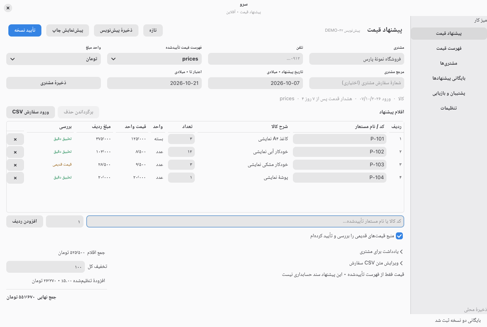
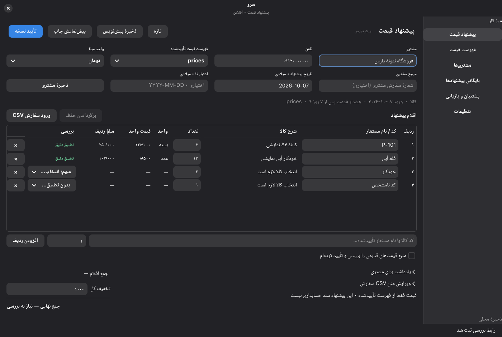
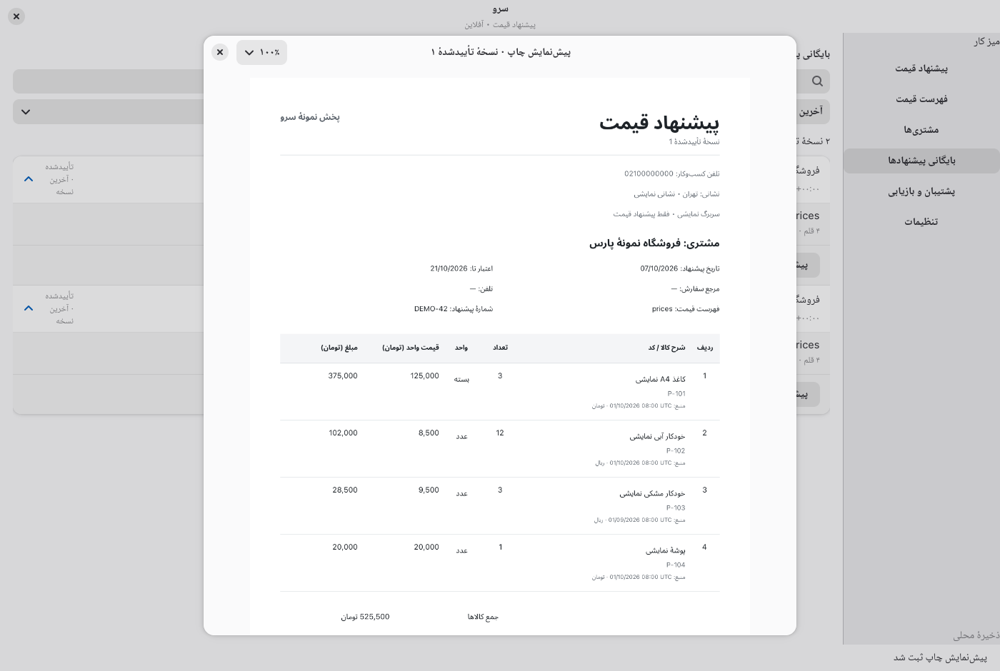
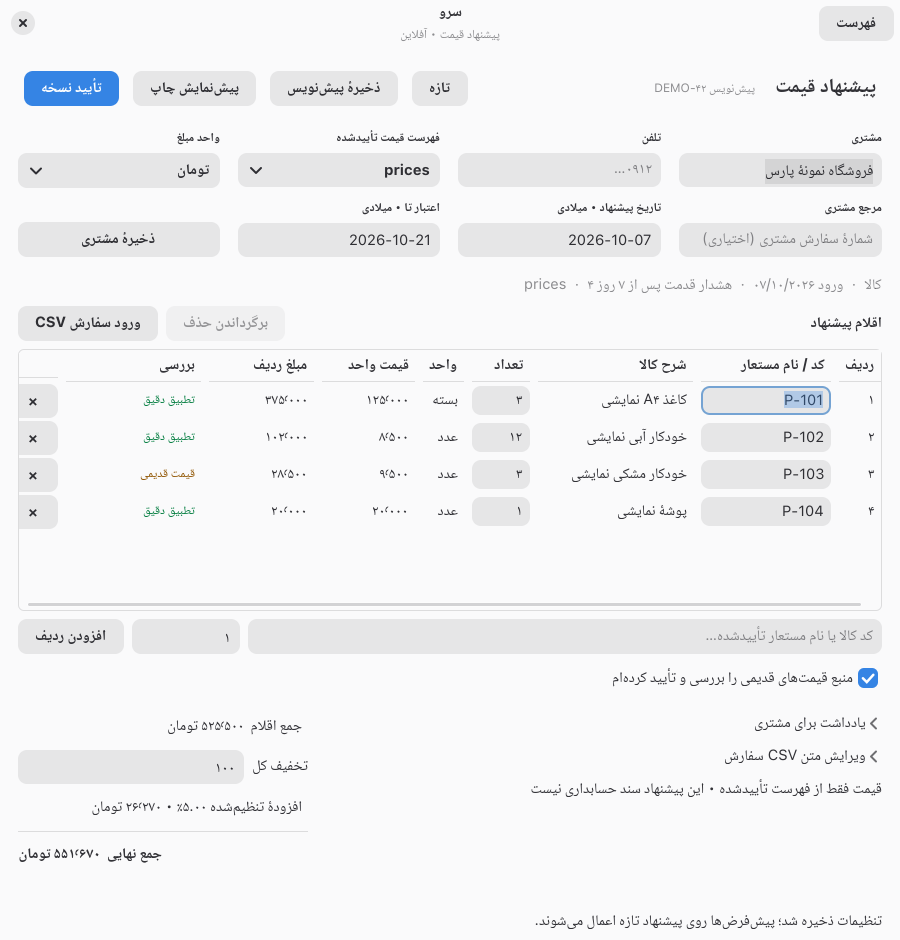
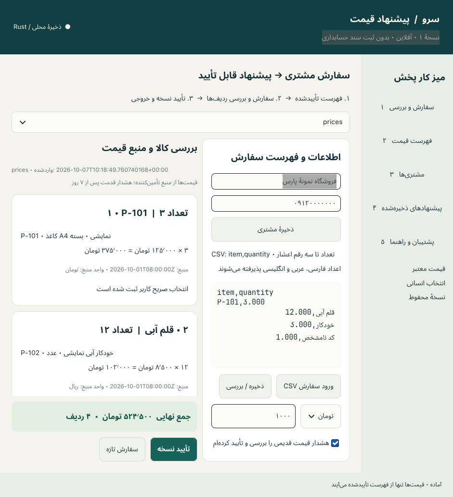
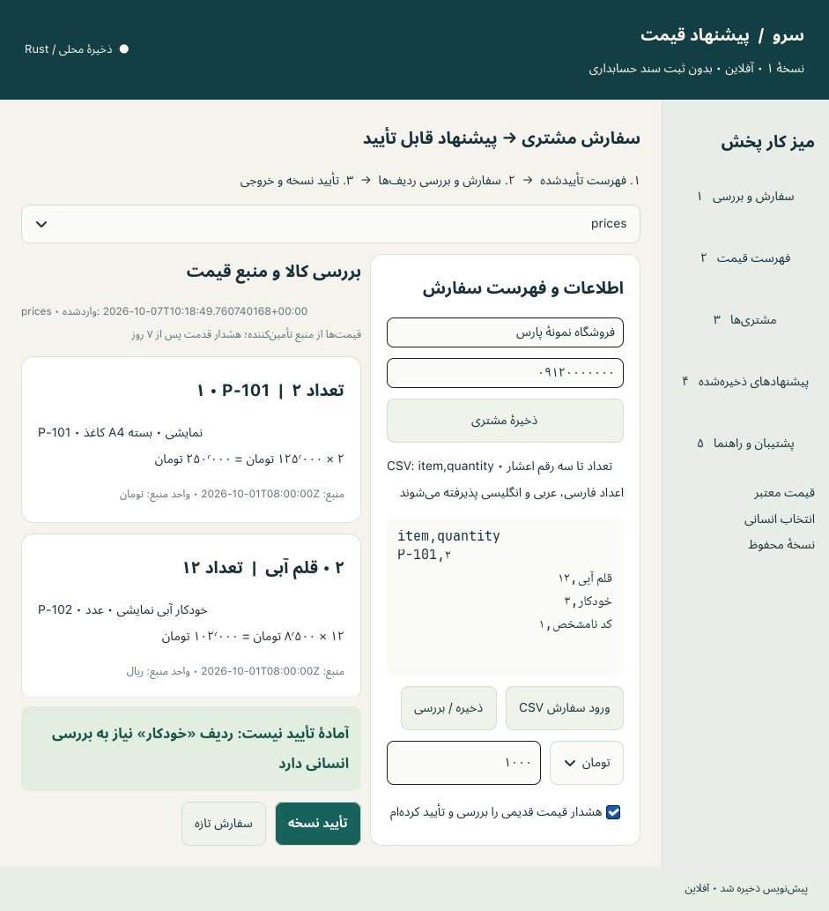
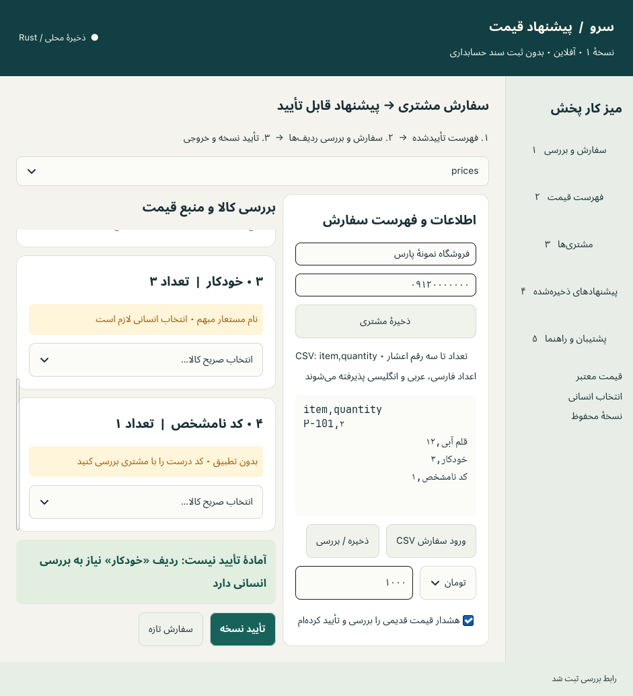
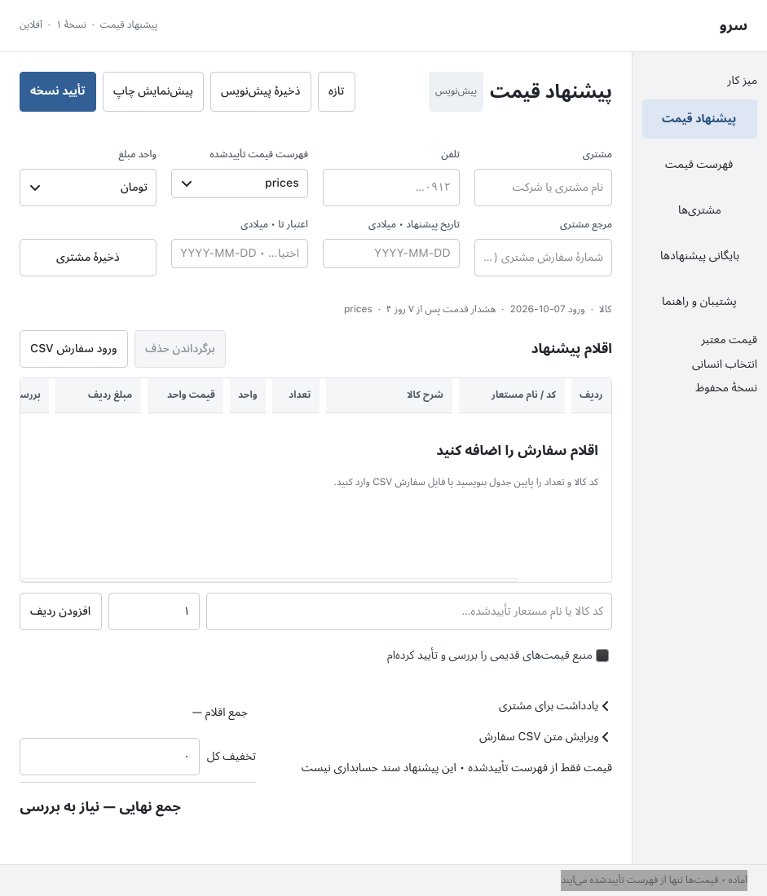
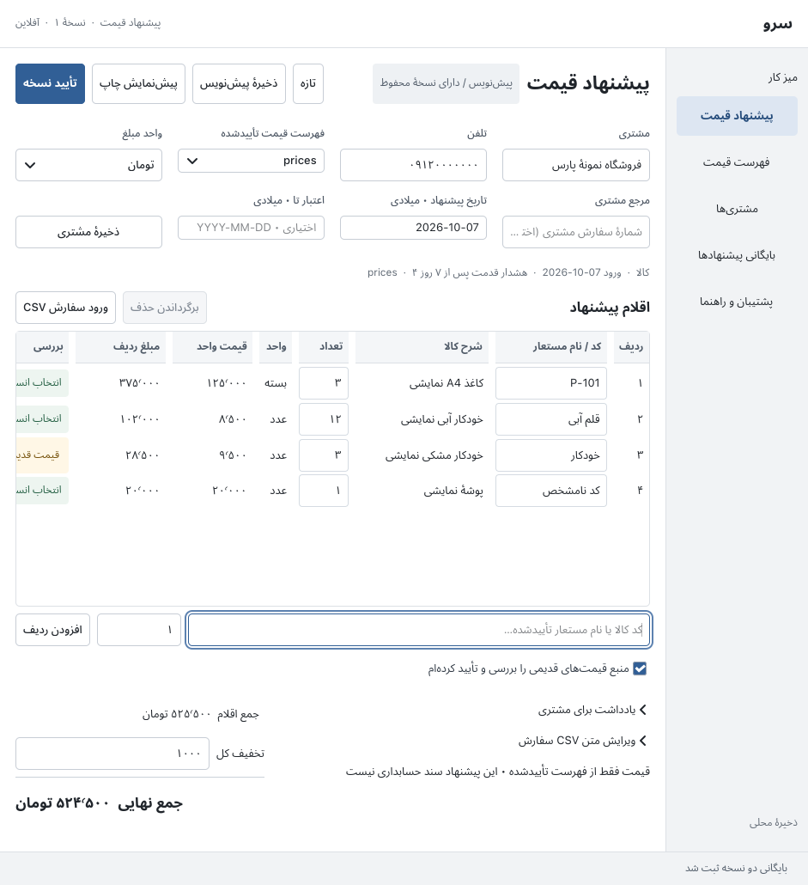
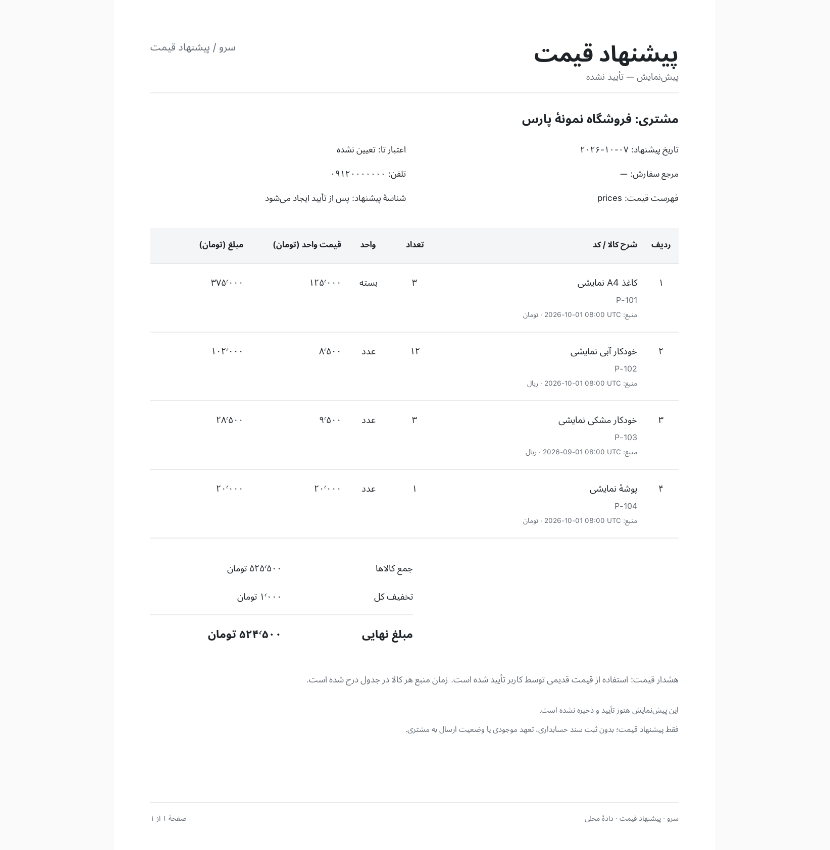

# Independent QA review
This is historical verification/design evidence. The current native product delivery, requirements and remaining limits are in [PRODUCT-DELIVERY.md](PRODUCT-DELIVERY.md) and [PRODUCT-ACCEPTANCE.md](PRODUCT-ACCEPTANCE.md).

Current continuation verification and before/after native captures: [CONTINUATION.md](CONTINUATION.md). The results below are retained historical evidence; the continuation report supersedes their outstanding native checks where explicitly tested.

The native screenshots and 39-check GUI acceptance below describe the preceding local v1 build. The current snapshot includes subsequent software-risk fixes; see [SOFTWARE-RISKS.md](SOFTWARE-RISKS.md) for current checks and remaining native verification.
Scope: quotation preparation v1, native Rust/GTK4/libadwaita. Synthetic records only. This review makes no accounting, tax, accessibility-compliance or production-scale claim. Earlier screenshots and findings below are retained as historical evidence; the final acceptance section describes the delivered interface.

## Final native acceptance

Opened the actual Wayland captures in `../artifacts/delivery-complete/`: quotation, human review, catalog confirmation, products, customers, settings, quote archive, and approved print preview. At 1400×940 the four-line quotation displays every quantity, price, amount, review selector and delete action without horizontal scrolling. Both dark and light captures show joined Persian text, persistent captions and visible native focus. Ambiguous/unmatched rows withhold totals until human resolution. Source timestamps, stale-price acknowledgement and explicit toman units remain visible. The products page wraps each amount/unit caption into several short lines; it stays readable. The settings capture covers the upper business/document fields, not all settings below the scroll. `native-quotes.png` is the archive evidence; the file named `native-archive.png` captures the quotation page.

The final 900×940 capture `native-narrow.png` was also opened. The collapsed sidebar is reachable through the visible native Persian button `فهرست`, replacing an unavailable theme icon. All four rows and numeric columns remain legible; the table has horizontal scrolling available at this size. This capture proves the button is visible; source inspection confirms it switches the collapsed split view to its navigation pane. This reviewer did not click the running window.

Read the final native reports and corresponding harness source: **22 workflow + 14 settings + 3 saved-preview checks passed**. These use actual GTK/libadwaita controls and Wayland rendering. The approved-preview title identifies the saved approved version, numeric price/total columns are distinct, and the harness verifies 125%, 75% and restored 100% zoom geometry. The settings run verifies Gregorian date-format snapshots, exact configured 5% arithmetic, and number `DEMO-42`: subtotal 5,255,000 rial less 1,000 rial discount, plus 262,700 rial configured charge, equals 5,516,700 rial (551,670 toman).

Independently inspected final automatic recovery files. `before-new-draft-decb0a46-d1de-4bb9-b538-beef8f5d8fa4.json` retains the prior four-line draft. `before-new-draft-3409abe0-984d-491c-9762-9a6971967684.json` retains a zero-line draft with customer `یادداشت مشتری پیش از ورود اقلام` and notes `یادداشت ساختگی پیش از اقلام`. This closes the metadata-only retention gap; the native harness asserts those exact values before accepting New. Save/snapshot failure still blocks replacement.

The final restore safety snapshot `before-restore-c282e5d2-37e3-4f51-958e-876d0576a489.json` contains the immediate edit `تغییر موقت برای آزمون بازیابی` with four lines; the restored `backup.json` contains the original customer `فروشگاه نمونهٔ پارس`. Independently compared final `before-restart-state.json` with current SQLite: values equal, generation 32, three quotes and four draft lines. Raw persisted payload SHA-256 is `aa907678c2858a16ee7dfa24473cfce23a1e9b850e35b90211ff70bcb86d4aa2`, matching `restart-before.json`. The subsequent controlled restart report records native close, original process exit and launch of a new process with the exact release binary and isolated profile. Its post-restart hash and generation match this baseline. A further independent read-only SQLite check after that report confirmed the same payload, three quotes, four lines and next number 43.

The final Rust log contains **69 passed, 0 failed**, with the one graphical lifecycle test intentionally ignored in the ordinary suite and separately passed on Wayland. The optimized release build completed. Independently reran `cargo test --offline --test qa_invariants` after final integration: **10 passed, 0 failed, 1 ignored**, runtime 0.02 seconds. The separate `restart-verification.json` and `keyboard-verification.json` also passed. The keyboard report and its event records show real Wayland keys sent after confirming focus on the isolated app: Tab to quantity, Shift+Tab back to item code, Ctrl+S, Ctrl+Enter, Alt+6 to settings, Ctrl+S there and Alt+1 back to order. All eight assertions pass, with no duplicate approval or payload change. The current release binary SHA-256 recorded in both reports is `058e3818a1a7bf2bc7d53790ae8c1fc4a6087da66c8fed52a15bd2a4b925fcc9`. This reviewer read the reports/event records and opened the post-restart `native-narrow.png`; the integration owner performed the GUI actions. An independent hash of `target/release/sarv-quote` also matched the recorded binary.

## Evidence and method

Application source, existing workflow tests, and independent `tests/qa_invariants.rs` were inspected. No desktop windows were manipulated by this reviewer; the integration owner coordinates native widget execution and captures. Screenshots below were explicitly supplied for review and opened as local images before accepting them as evidence. They are baseline evidence, not evidence of the redesign.

| Step | Evidence | Baseline health |
| --- | --- | --- |
| 1. Existing quote draft | `../artifacts/final-native/native-baseline-order.png` | Persian shaping and right-side navigation are visible. A four-line quote shows only two product cards at once; quantity, price and total are difficult to compare. |
| 2. Resolved item review | `../artifacts/final-native/native-review.png` | Customer, requested rows, explicit units and source timestamps are visible. Editable order is CSV text, requiring users to understand its syntax. |
| 3. Human review | `../artifacts/final-native/native-human-review.png` | Ambiguous and unmatched rows show distinct textual warnings and explicit selectors. Dense customer/order details occupy a separate panel while useful item data requires scrolling. |

## Findings communicated to integration owner

1. **High — invalid draft edits can disappear after a failed action.** Baseline archive revision and new-draft handlers call `fill_form()` even when `save_form()` fails. An invalid order/discount remains unsaved, then the widgets are overwritten from the previous persisted draft. Requested fix: return on save failure; retain input and focus. A native regression must type an invalid value, invoke both actions, and verify the exact text remains.
2. **High — restore safety backup can omit the latest edits.** Baseline restore confirmation cancels the pending autosave and calls `restore()` without first saving current form values. Requested fix: flush valid edits before taking the automatic safety backup; reject the operation while invalid edits remain. Native regression must restore within the debounce interval and inspect the pre-restore backup, rather than merely assert that a backup file exists.
3. **Medium — empty search results need a message.** Baseline archive/customer search filters produce a blank list when records exist but the query has no matches. This is distinguishable from a true empty workspace and should state “no matches” with a clear way to clear the query.
4. **Medium — persistent labels and table semantics need verification.** Baseline customer/phone/discount controls rely on placeholder text rather than visible field labels. A quote table should provide persistent labels, meaningful accessible names for quantity/code/review controls, and a visible focus ring. Screenshot evidence does not prove accessible-name association or screen-reader traversal.
5. **Medium — the baseline item cards reduce comparison density.** The draft screenshot displays two of four requested lines while several large buttons and explanatory paragraphs occupy the fixed form panel. The approved direction should use a compact editable item table with aligned quantities/prices/totals and explicit units; avoid forcing customers to edit CSV syntax for ordinary entry.
6. **Medium — stale-price acknowledgement can carry to a changed catalog.** Baseline catalog selection merely schedules a save; `save_form()` retains the checkbox even when the catalog changes. Reset acknowledgement when the chosen source changes so an earlier confirmation cannot approve a different stale catalog. Old approved records must keep their original acknowledgement.

Source review after integration confirmed corrected save-error branches, save-before-restore safety backup, immediate unsaved-edit status, no-match messages, explicit accessible `LabelledBy` field relations, and stale acknowledgement reset when the catalog/requested source changes. These are source-level confirmations; their native regressions remain part of final acceptance.

## Redesign integration review

The actual native capture `../artifacts/final-native/native-redesign-first.png` was opened. This is an empty quotation with an approved catalog, not a complete populated-flow acceptance capture.

| Step | Evidence | Observed health |
| --- | --- | --- |
| 4. Redesigned empty quote | `../artifacts/final-native/native-redesign-first.png` | Calm toolbar, persistent Persian captions, direct item table, explicit amount unit and right-side navigation are visible. At the approximately 941 px window width the review/action columns require horizontal scrolling. Populated/full-width review is pending. |
| 5. Printable continuation | `../artifacts/document-review-final/multipage-01.png`, `multipage-02.png`, `multipage-09.png` | Inspected first/continuation/last pages: long descriptions and notes wrap; Persian text joins; SKU strings, units and numeric columns read correctly; page counts repeat. |
| 6. Populated quotation and review | `../artifacts/redesign-final/native-review.png`, `native-human-review.png` | Four requested rows compare in one table; exact matches, ambiguity and unmatched choices are distinguishable. Persian/Latin codes and input focus are legible. Review and delete columns require horizontal scrolling in the tiled approximately 941 px window. |
| 7. Saved quotation and preview | `../artifacts/redesign-final/native-after-quotation.png`, `native-print-preview.png` | Resolved rows show original/human matches and stale source warning. Final total is 524,500 toman = 5,245,000 rial. Native preview clearly states it is an unapproved preview and does not imply dispatch/accounting posting. |

Additional integration defects were reported directly to the owner:

- Whole-list undo replaced edits made after deletion. Source now stores/reinserts only the removed row, preserving other edits; context resets on revision/restore/import/catalog change.
- A review dropdown could target an obsolete row after advanced CSV edits. Source now checks the current row exists and its requested identifier still matches before applying explicit selection.
- Deferred focused-table refresh could display old product details next to an edited request. Source now marks description/amount as pending and requires a review refresh before approving changed requests or quantities.
- Read-only selectable labels could add unwanted Tab stops in the table. They are now nonselectable; final actual keyboard traversal remains separately verified by the integration owner.

The export agent fixed a Pango raster glyph-cache issue found independently on old intermediate continuation pages. The final first/continuation/last pages inspected here are good. Later image-tool views were inconsistent: `quote-table.png` appeared blank despite a full nonwhite bounding box, and draft views appeared to join numeric columns. The export owner independently compared each PNG column with a PDF raster at the same resolution: each row had matching separate total/price ink regions, and the supposedly blank approved page contained more than 26,000 dark pixels in its upper region. The residual inconsistency is in image-tool display, not a confirmed final export defect. Final export tests should retain objective repeated-raster placement assertions; a native preview-window capture remains useful visual evidence.

Token-level sRGB contrast calculations for the revised CSS: primary text 6.55:1, muted text 5.41:1, field captions 7.57:1, errors 6.64:1, warnings 6.61:1, status text 6.22:1; focus outline against white 3.97:1. These calculations cover declared color pairs only, not full rendered accessibility compliance.

Those explicit color tokens belong to the earlier GTK redesign. The later libadwaita migration removed them; libadwaita now owns theme colors, typography, control states and focus. The earlier contrast numbers must not be cited as verification of the current libadwaita light/dark/high-contrast themes.

The native widget harness report `../artifacts/redesign-final/native-verification.json` reports **passed** for 22 scenarios, including invalid-cell preservation by New/Revision/Approve, immediate unsaved status, delete–edit–add–undo preservation, product review/stale re-acknowledgement, and restore from immediate widget edits. This reviewer read both the harness source and result. The harness used actual GTK widgets/signals but is distinct from a manual keyboard/screen-reader session.

The safety-backup claim was independently checked in the produced artifact: `before-restore-e17b2e1b-4da7-4c47-8717-ee3f4c4db80f.json` contains the immediate customer edit `تغییر موقت برای آزمون بازیابی`; `backup.json` contains the original customer `فروشگاه نمونهٔ پارس`. This proves the pending edit reached the safety snapshot before replacement in this run.

## Libadwaita migration follow-up

The supplied actual screenshot `../artifacts/native-final-v1/native-libadwaita-first.png` was opened. Its native dark appearance, 1400×940 layout and visible table headers are readable; it shows an empty editable draft, not the populated harness state. Table labels are now nonselectable, removing the earlier avoidable Tab-stop risk. Field controls retain explicit accessible label relations.

A read-only check of this profile's SQLite record found generation 22, two intact four-line approved quotes, and a zero-line draft. The empty draft's series is `aa73c17b-fbee-4097-8a9d-8eb847cc5c03`; the backed-up four-line draft and both approved versions use `83298ee3-d4f4-409b-aeda-03f9fd9d15b3`. Current save/close paths do not alter the series. Consequently an empty-buffer flush at close cannot alone explain this artifact; a new/reset/replacement action generated a different series earlier. Keyboard logs observed modifier keys but do not prove the origin of that action. No automatic draft reset was found in navigation/theme or window-close callbacks. The integration owner subsequently ran the isolated final full-flow → close → reopen comparison described above, preserving every payload byte. Earlier live desktop interactions were not fully logged, so no automatic data-loss cause is inferred from that historical empty-draft screenshot.

An independent opt-in native-widget lifecycle test was added to `tests/qa_invariants.rs`. It initializes GTK/libadwaita but creates no application or windows. On the actual Wayland runtime it passed: ten programmatic ToggleButton active-state cycles emitted zero `clicked` signals; removing and dropping a populated Entry emitted zero text-change callbacks. This rules out those two lifecycle hypotheses on this runtime. The ordinary suite intentionally ignores the graphical test for headless portability; its explicit run was **1 passed, 0 failed** in 0.05 seconds. Initial sandboxed attempts failed to initialize GTK because the display socket was unavailable; the authorized escalated local-display run succeeded without changing desktop settings.

New settings/managers source review found success-guarded draft use/revision actions and staged settings persistence. One additional unit issue was reported: changing settings' default currency could reinterpret its existing default-discount digits. The follow-up source now converts through canonical rials and reverses the selection/focuses an error when the prior value is invalid. The final native settings verification should exercise this transition explicitly.

The supplied `../artifacts/settings-document-review-final/business-quote-01.png` and `business-quote-02.png` were opened. The first page shows business identity/header, `SQ-0042`, Latin-digit prices and quantities, separately stated discount/configured rate, and total 34,140.1 toman (341,401 rial). The second page carries configured terms/footer and the statement that a user-configured rate is not a legal-tax-compliance claim. The CSV contains the same amount and versioned business metadata. This is review of supplied synthetic export evidence, not statutory validation.

One product-retention issue was reported to integration: New/Ctrl+N previously saved a valid current draft, then replaced it with a fresh draft without recovery for the unapproved proposal. Current source now calls `preserve_draft("new-draft")` before replacement and blocks the operation if snapshot creation fails. The produced `../artifacts/delivery-v1/before-new-draft-96167251-5987-4248-8087-4549b4c2242a.json` was read independently and retains the prior four-line draft. A follow-up found metadata-only customer/phone/reference/notes drafts were excluded; the predicate now includes those fields. Final native regression and independent recovery-file inspection passed, as recorded above. Deliberate New remains distinct from passive close/restart.

The supplied `../artifacts/delivery-v1/settings-native-verification.json` reports 13 passed native settings/business checks, including canonical default-discount conversion, exact configured rate, stable numbering/repeated approval, appearance/density/digit settings, saved business snapshots, customer dialog, reopened SQLite and exports/backups. Current source also rebuilds staged settings controls following restore.

An independent read-only comparison of `../artifacts/delivery-v1/before-restart-state.json` against that profile's current SQLite payload found exact value equality with three quotes and four draft lines (generation 30). Canonical sorted-key UTF-8 JSON SHA-256 matched on both sides: `4d141985af0ee356d472148e5648150f92116130980e7a00edeb15c1b957d79c`. This comparison proves state consistency at inspection; process close/reopen evidence must accompany it before interpreting it as a controlled restart result.

## Independent regression coverage

`tests/qa_invariants.rs` adds independent checks for:

- Every rial amount from 0 through 10,001 plus upper-bound values round-trips through both unit representations; fractional quantities follow the documented half-up rule.
- An exact normalized code takes precedence over another product's alias. Ambiguous approval is rejected without creating any records; explicit human selection succeeds.
- A candidate approval followed by a closure error cannot leak a customer, quote or draft change into memory or reopened SQLite storage.
- A stale writer cannot publish a quote after another instance writes; its local candidate is also discarded.
- Revising an old version appends the next version, preserves all earlier snapshots, and remains idempotent on repeated approval.
- A price fresh at historical approval remains valid for backup/restore when it has since aged.
- Restore's safety backup contains the exact pre-restore persisted state. An invalid restore candidate leaves memory, disk and directory entries unchanged.
- Customer/requested-item CSV formula markers are escaped and existing output bytes are preserved.
- A correctly checksummed backup with an invalid revision chain is rejected.

Executed `cargo test --offline --test qa_invariants`: **10 passed, 0 failed**. Rerun after the current domain/export/storage integration also passed, test runtime 0.02 seconds. The first run's CSV assertion used fixed column positions and failed after the export module added a phone column; the assertion now selects fields by header name. This was a test-maintenance correction, not an application defect. Source changes were ongoing at that point; the final aggregate run later passed as recorded above.

The later libadwaita/settings-library rerun passed the same 10 domain/storage/export tests in 0.03 seconds. The additional ignored graphical lifecycle check was separately run with `XDG_RUNTIME_DIR=/run/user/1000 WAYLAND_DISPLAY=wayland-1 GDK_BACKEND=wayland cargo test --offline --test qa_invariants native_widget_lifecycle -- --ignored --test-threads=1` and appropriate authorized display access, passing 1/1.

## Limits and remaining verification

- Empty/populated/review/preview captures and the native widget report above were inspected. Final Tab/Shift+Tab traversal and page/save/approve shortcuts passed in the supplied real-keyboard report; the final full-width capture verifies that all table controls can appear without horizontal scrolling.
- No screen-reader session, high-contrast theme, physical printer, color-vision assessment, alternative display scaling or very large datasets were exercised by this reviewer.
- SQLite transaction tests verify logical failure atomicity and restart; they do not simulate power loss or hardware faults.
- A checksum protects backup consistency, not authenticity or confidentiality.
- Final aggregate test/release-build and native widget evidence is recorded above. Format/lint command completion is reported by the integration owner; this reviewer did not rerun the whole build pipeline.
