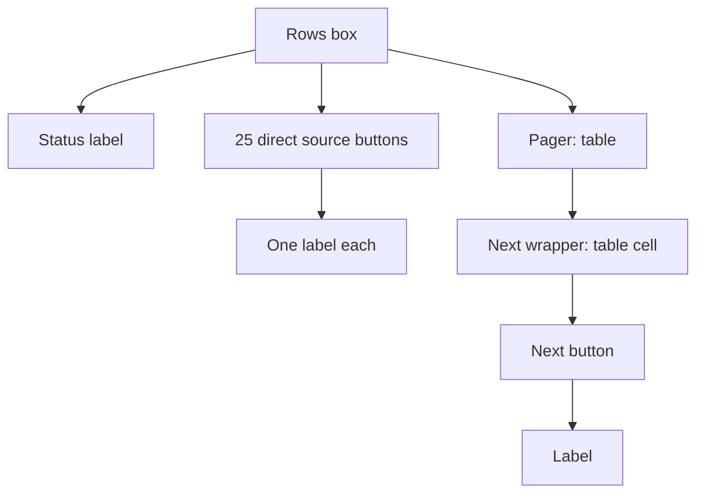

# Actual C8 source hierarchy: one read-only probe

One authorized fresh synthetic source120-billed copy opened Purchases and its initial unfiltered source picker. No query, warmup, input, timing sample, post or return workflow ran. [Before/after raw hierarchy](result/hierarchy-probe.json) contains56 exactly matching current nodes. All nodes have the owned PID, DEFUNCT=false, fresh current parent-child edge and current owned-modal ancestry. Query stayed empty and stopped generation/payload stayed exactly prepared with SQLite integrity `ok`. All newly owned processes closed before curation; source/runtime/binary/dataset/protected-seed guards match. [Screenshot](result/actual-source-picker-hierarchy.png), [stopped State](result/stopped-state.json), [integrity receipt](result/stopped-profile-check.json) and [manifest](result/portable-manifest.json) are portable; no executable/SQLite copied.

The actual rows node has27 direct children: one status label,25 source buttons and one FlowBox pager bar exposed as role`table`. Each source button has one label child. The pager table has one current Next wrapper role`table cell`, with matching name`منابع بعد`; the wrapper owns exactly one role`button` with the same name, and that button owns one label. These current memberships/roles/names/child lists were independently refreshed before and after the screenshot. Original observer930730bf required pager buttons directly under the table, so its retained C8 runtime1 pilot failed outside timing. No product defect is established by that observer mismatch.

Sidecar source SHA85f860d41ec6e84b34300a6eac95c6496699dfc267e0010c941e4d790d91c9df imports held observer930730bf and immutable failed receipt e1e3ca060d1b0b1b46de0161e6e85bcaf9b3ee7db4c108334ab4dede81287784. The bounded factory-aware proposed adapter must explicitly refresh table→cell→button membership plus button descendants before/after readiness, reject nested source actions/unknown nodes/foreign ownership/DEFUNCT or mixed replacement, and retain exact query/status/count/page/FSI/readiness/focus. Initial Next qualifies actual topology; future Previous/Next must use the same strict current wrapper shape and known literal names/order. Native future filtered pages remain pending. No canonical edit or replay is authorized by this probe. Final quiet epoch remains unauthorized.

## Strict adapter proposal, canonical unchanged

[Proposed source](observer-proposal.py), [exact diff from held930730](pager-adapter.diff), [63-case isolated AST receipt](static-check.json), [check source](adapter-static-check.py) and [proposal hashes](adapter-proposal.json) are static-only. Proposed protocol`m6-scoped-v2.1` retains direct source rows and exact current query/count/page/FSI/readiness/focus endpoints. The actual factory constraints are explicit: status label has no children; pager is role`table` with empty name; at most two ordered role`table cell` wrappers, each owns exactly one current button with the same full name and literal Previous/Next caption; every source/pager button owns exactly one live same-full-name childless label. All nodes/edges are freshly owned/non-DEFUNCT and snapshots before/after readiness must exactly match. Unknown wrapper/extra child, hidden status action, nested caption action, foreign/retired/reparented node, duplicate pager, mismatched name or mixed update rejects. The source button shape is no longer an arbitrary learned descendant role pattern.

Existing63 cases cover strict current source/editor predicates, the original extra nested source adversarial, actual wrapper/current-parent/owner/DEFUNCT/name races, childless captions/status, exact empty bar name and unchanged finance/preview400/startup/native phase AST. These are isolated fake predicates, not current native C8 filtered-page/workflow qualification. No thresholds or inputs/post/restart checks change. Canonical observer930730 and failed runtime1 receipt/pilot remain unchanged. Root authorization, independent review, new runtime freeze/receipt and separate pilot GO are required before installing/running this proposal; no whole-pilot replay occurred.

## Authorized verbatim canonical installation

Root authorized installing the exact independently reviewed proposal after63 author AST and88 independent actual-AST/recorded-native-subtree checks passed. Canonical observer is now protocol`m6-scoped-v2.1`, SHAcb145aed5a13d289f8222083f3d23e67ef9c95759745c2d4aea9ecc391945408, installed byte-for-byte from the preserved proposal. [Installation/static guard receipt](canonical-install.json) and [actual canonical AST checks](canonical-static-check.py) retain63 passing cases and pycompile. Historical930730 source is [archived](observer-v2-930730.py); the failed runtime1 receipt/pilot and original proposal remain unchanged. Runtime1’s74-file manifest is now historical: exactly the observer changed; other73 files, production, binary,38 datasets and two protected seeds remain exact. Fresh root runtime2 freeze/receipt and separate pilot GO remain required. The read-only56-node native hierarchy is qualified, while full current200-line functional/settled/user-focus/post/restart/startup qualification and final quiet measurements remain pending.

Current [C8 runtime2 immutable receipt](../candidate8-runtime2-coordinator-receipt.json) and [twice-exact full static guard](../candidate8-runtime2-static-guard.json) bind74 current runtime files under manifestbfa90418996771f2ecd1d0040c7a24729e32367ed0266eeb397a2b9abdeb117e, preserving production/binary/dataset/seeds. No GUI starts from stamping. Complete current functional pilot requires root quiet GO; final n10/n20 remains separately authorized or explicitly pending under integration steering.

The one authorized [C8 runtime2 full-functional attempt](../candidate8-runtime2-pilot1-partial/README.md) ended partial with observer exit139 after both source modes qualified their actual factory/query/page/receipt/cancel predicates. All source arrays survived; no final observer report or exact crash frame exists, and current return200/settled/user-focus/post/restart/startup remains incomplete. Canonicalcb145 stayed unchanged, with no further repair/replay authorized under user integration priority. Final n10/n20 is explicitly pending; no current full-scope/timing acceptance follows.
