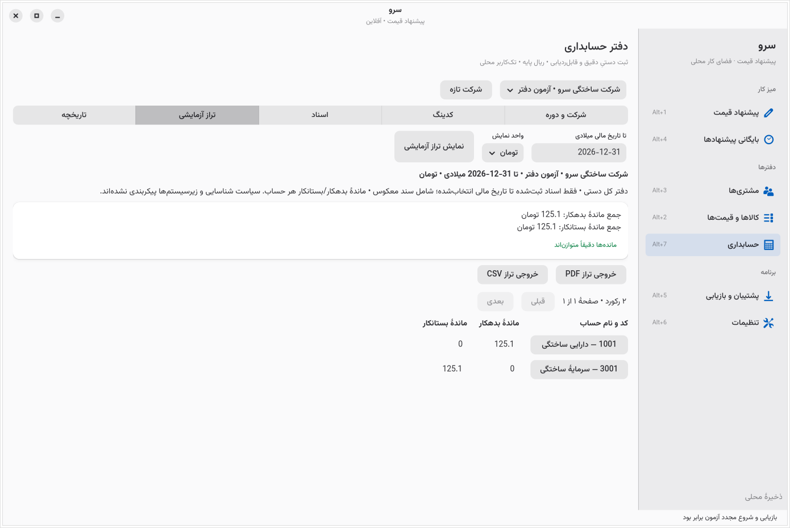

# M1 local checkpoint — company setup and manual books

A usable native manual-ledger workflow is implemented alongside the preserved quotation application. It creates company books, an explicit custom chart and fiscal periods; posts a balanced initial opening and manual journals; prevents duplicate economic effects across different retry keys; reverses journals without deleting history; locks/reopens periods with reasons; and exports a cumulative trial balance. Save/Ctrl+S/autosave and accounting persistence run on workers. This is a bounded checkpoint, **not full G1, production readiness or Iranian tax compliance**.

The implementation/evidence local commit is identified by local tag **`sarv-m1-local`** on `codex/accounting-baseline-m1`. Nothing was pushed, merged or deployed. Runtime release SHA-256: `65bedf489894bd6435b57a9919fadf0a31e2e1d9809f97089212dbf43bfc4378`; final measured Rust/CSS/Cargo source hash: `115c2e7425e4f1bc2388fd9720c678fbddc96ba3312634b405b0a5d79bdfe6f4`. Logs taken before the local commit correctly show baseline HEAD plus dirty implementation. No dependency/lockfile changes were required.

## Baseline and authority

Both [requirements](Sarv-Accounting-Requirements.md) and [execution brief](Sarv-Agent-Execution-Brief.md) were read completely before planning. PDF and DOCX companions were readable/extracted; they were not independently reconciled word-for-word. Their embedded instructions/proposals are distinct from the user's request: current native-stack, authority boundaries and confirmed decisions take precedence over historical guide references. The [126-ID map](evidence.md) preserves frozen baseline classifications and supplies a current overlay; the [roadmap](roadmap.md) retains every later gate and advanced module. Official Holoo, Hesabfa, Sepidar, Zoho Books and GrandTotal capabilities are mapped in [documentary research](research/official-workflows.md), with edition/jurisdiction/entitlement limits. No universal parity or comparative superiority was established.

Initial checkout was clean branch `work` at `c21c4ed`, behind current remote main. Read-only remote verification/fetch established merged main `4aa82c2988fb2ea48a2fa2ae9824c06187f3d76a` and UI-pass `6ee93a8`; a new branch continued verified main. The original branch/data were retained; no reset/rebuild of data occurred. Current/historical agents and task status were inspected before assigning six non-overlapping agents: kernel, accounting UI, evidence, native save, performance and independent review. Root is the integration and sole schema/migration owner. Seven active slots were the actual limit; completed agents were reused for follow-ups.

Baseline was a native quotation workspace, schema 1, one generation-guarded JSON state row inside SQLite WAL/FULL, 64 MiB backup bound. It had no accounting aggregate/migration sequence. Baseline regression passed **105 ordinary tests** ([raw](../docs/assets/accounting-m1/checks/accounting-baseline-tests.log)). Actual merged source was rebuilt for native before captures. Its synchronous changed save/page action took 316.664 ms and worst 20 ms heartbeat gap was 810.166 ms in one synthetic run. Its exact binary SHA was not retained, so source-level provenance is stated rather than invented. GTK focus diagnostics were **not reproducible before or after**; the focus handoff fix is protective, not proof of a historical cause.

User approved canonical integer IRR, exact 1 toman = 10 rials and rejection of fractional rials. Audience response was **“anyone”**; no service-only launch scope was silently selected. Existing quotation rounding/snapshots remain unchanged. A default accountant chart, tax, recognition, inventory valuation, closing and future distribution license remain undecided in [decisions.md](../decisions.md).

## Completed bounded workflow checklist

“Passed” below means technical evidence for the named slice. Full requirement coverage stays partial where it includes absent policy/subledgers, permissions or other workflows; accountant/representative-user acceptance is still pending.

| Check | IDs / named scope | Result and evidence | Remaining requirement gap |
|---|---|---|---|
| Preserve native quotation work | BASE-01/02; SAL-01/02/05; UX-06–09; SET-01/02 | **Passed subset:** 40 native quotation/settings/preview checks, 3 retained approved quotes on restart; ordinary regressions. [Log](../docs/assets/accounting-m1/checks/accounting-quote-native.log). | Sales order, delivery, invoice, customer acceptance, stock and payment states are absent. |
| Company, explicit fiscal dates and custom chart | ACC-01; IR-03; SET-01/02 | **Passed subset:** persist/restart, hierarchy/company/period/date/overlap restrictions, deliberate account classification/normal side and control flags; native forms. | Gregorian only; no Jalali entry/timezone model, approved chart templates, policy wizard or full party roles. |
| Exact accounting money | MNY-01/02; MNY-03/04 subset | **Passed bounded policy:** Persian/Arabic/Latin digits; exact rial/toman including signed i64 bounds; checked amounts/overflow; fractional rial rejected. | New invoice/tax/valuation rounding, allocation/scales/versioned policy not configured. Quote policy preserved. |
| Initial balanced opening and manual journals | ACC-02/03; OPEN-01 subset; POST-01/02 subset | **Passed subset:** opening 1,251 IRR; adjustment 349 IRR; one-sided positive lines, balanced totals, correct company/date/accounts; invalid commands leave state unchanged. | Only one initial company opening; no annual closing/carry import, AR/AP/stock/cash/cheque subledger opening reconciliation. Unsupported control postings blocked. |
| Atomic/duplicate-safe persistence | ARCH-02/03; ACC-03; QA-01/02 | **Passed subset:** business source/revision/event identity independent of retry key; repeats return one journal; conflicts reject; actual persisted history checked inside BEGIN IMMEDIATE; generation guards, no recreation of missing database. | Snapshot aggregate is not million-line indexed SQL; API caller must retain a stable event identity. Separate manually entered source IDs represent distinct events. |
| History, reversal, lock and audit | ACC-04/05; CTL-03 subset | **Passed subset:** exact linked reversal retains original snapshots, including archived account; once-only reversal, locked-date rejection, explicit reopen reason; replay validation; cached-state mutation cannot erase history. | Single local actor, no enforced role/approval separation; no closing workflow. Audit checksum is not authenticated/tamper-proof against filesystem access. |
| Trial balance, drilldown, export | ACC-06; RPT-01/04 subset; UX-11 | **Passed subset:** cumulative posted history through cutoff, same-company account drilldown, exact rial/toman, PDF/CSV identity/basis/status/unit; page headers and formula-safe CSV. | No P&L/BS/aging/GL running-balance report, operational reports or subledger control reconciliation. Oversized PDF cells fail safely with CSV fallback. |
| Recovery/migration | MIG-01; DATA-03/04; QA-02 subset | **Passed subset:** verified v1 recovery before schema2; stable quote snapshots; repeat-open idempotence; v2 full-state fresh restore; corrupt/unknown/history-invalid reject. Before/after commit SIGKILL tests preserve zero or one complete journal. | Interrupted schema upgrade, every kill boundary, physical power loss, scheduled backups, attachments and normalized-storage migration remain untested/absent. 64 MiB bound remains. |
| Native interaction and rendering | UX-01–14 subsets; IR-01/02/04 | **Passed bounded fixture:** 16 financial/native checks, independent rerun, narrow 650×760 and standard 1280×900 captures, actual XTest navigation/dialog/cancel; restrained stable native components, visible focus, explicit error/loading/unit states. | Not every financial field entered exclusively by keyboard. Dark/high-contrast/enlarged-text matrix, screen reader and Persian accountant task study not accepted. Quote narrow totals require scrolling. |
| Save/close responsiveness | ARCH-04; UX-09/13 subset; PERF | **Passed save-specific correctness:** 12 scale checks, newer/invalid input retained, double-save once, lock-held worker keeps GTK active; actual Alt+F4 waits then persists exactly once. | Snapshot cloning/widget construction and some dependent commands remain synchronous; global performance budget still fails. |
| Independent review and delivery | QA-01–03; EXEC-01–07; REL-01/02 subsets | **Evidenced:** separate reviewer probes and raw-state/PDF/CSV recomputation; material findings fixed and reproduced; this local artifact bundle. | No accountant, tax specialist, native-reader pilot or production/platform release acceptance. |

## Exact validation results

All checks ran locally in the available cloud executor; no hosted GitHub Actions runs were triggered.

| Command / check | Exact result | Raw evidence |
|---|---|---|
| `cargo fmt --all --check` | Exit 0 | [format](../docs/assets/accounting-m1/checks/accounting-format.log) |
| `cargo clippy --offline --locked --all-targets -- -D warnings` | Exit 0, no warnings | [Clippy](../docs/assets/accounting-m1/checks/accounting-clippy.log) |
| `cargo build --release --offline --locked` | Exit 0 | [build](../docs/assets/accounting-m1/checks/accounting-build.log) |
| `cargo test --offline --locked` | **127 passed, 0 failed; 2 graphical/font tests ignored in ordinary run** | [full log](../docs/assets/accounting-m1/checks/accounting-final-tests.log) |
| Explicit native lifecycle test under private Xvfb/D-Bus | **1 passed, 0 failed** | [lifecycle](../docs/assets/accounting-m1/checks/native-lifecycle.log) |
| Explicit bundled-font four-row A4 test | **1 passed, 0 failed** | [font/PDF](../docs/assets/accounting-m1/checks/font-pdf.log) |
| Existing native quotation/settings/preview checker | **40 passed**; restart retained 3 quotes and generation 37 | [quote](../docs/assets/accounting-m1/checks/accounting-quote-native.log) |
| `dbus-run-session -- /usr/bin/python3 scripts/accounting-qa.py` final binary | **16 passed**, normal exit/restart/fresh restore/native keyboard and narrow layout | [final rerun](../docs/assets/accounting-m1/checks/accounting-native-final.log) |
| Separate independent reviewer native run | **16 passed** on ae35fe5d…; reviewed accounting source unchanged in final65bed; later UI inspected separately | [review](independent-review.md), [native log](../docs/assets/accounting-m1/review/native-accounting-passed.log) |
| Independent targeted tests | **28 passed, 0 failed, 0 ignored** | [targeted](../docs/assets/accounting-m1/review/final-targeted-rerun.log) |
| Final native quote 50k products / 1,000 lines | **12 passed**; exact total **100,802,501 IRR**, all ten pages, no duplicate unchanged-save | [scale](../docs/assets/accounting-m1/after/native-responsiveness-verification.json) |
| Real XTest close during locked write | Passed; deferred close, one durable generation, reopen equal | [close](../docs/assets/accounting-m1/close/native-close-verification.json) |

Separate reviewer expected values were not derived from production trial-balance calculations. Reading raw SQLite lines yields three journals with debit/credit totals **[1,251, 349, 349] IRR**; final asset/equity **+1,251/−1,251 IRR**, original retained and linked reversal verified. PDF/CSV extraction yields **1,600 rials** before reversal and **125.1 toman = 1,251 IRR** after reversal. [Independent amounts](../docs/assets/accounting-m1/review/native-independent-amounts.json). Permanent financial guards cover ordinary/prepared/detached attempts to bypass persisted history plus explicit verified replacement. Actual process-kill tests cover before worker commit and after durable commit/before receipt, then restart/integrity and fresh restore.

## Migration and compatible recovery rehearsal

A retained synthetic three-quote schema1 fixture was reconstructed using the unchanged compatible `4aa82c2` library. The current Store upgraded generation42→43 only after verifying a v1 recovery. Exact quote serialization SHA256 stayed `0c5c11fa3810adc9ccd37c05c33b829c27622a6f70ee98d52d6ec3335080d8eb`. Reopening remained generation43; fresh v2 full-state restore matched; SQLite integrity was `ok`. The compatible old library restored that actual pre-upgrade v1 file into a new schema1 profile with all three quote snapshots intact. Extracted old/restored versus current/upgraded quote PDF text matched exactly. [Raw report](../docs/assets/accounting-m1/migration/migration-verification.json), [retained recovery](../docs/assets/accounting-m1/migration/verified-before-schema2-v1.json), [v2 backup](../docs/assets/accounting-m1/migration/upgraded-v2.json), [sample migrated quote PDF](../docs/assets/accounting-m1/migration/migrated-quote.pdf). This rehearses a recovery path, not an automatic downgrade of new accounting data. See [migration boundaries](../migrations.md). Interrupted schema upgrades remain untested.

## Native before/after and sample outputs

Before is actual baseline quotation scale; there was no accounting UI at baseline. Empty-accounting and completed-accounting screenshots show the new workflow's progression, not an invented previous accounting implementation. Screenshots were inspected as native renders; their financial numbers were verified independently.

| Before | After |
|---|---|
| [Baseline 1,000-line quote](../docs/assets/accounting-m1/before/native-scale-editor-1000.png) | [Current 1,000-line quote](../docs/assets/accounting-m1/after/native-scale-editor-1000.png) |
| [Baseline narrow quote](../docs/assets/accounting-m1/before/native-scale-editor-narrow.png) | [Current narrow quote](../docs/assets/accounting-m1/after/native-scale-editor-narrow.png) |
| [Before explicit Save](../docs/assets/accounting-m1/after/native-save-before.png) | [After explicit Save, row refreshed/focus retained](../docs/assets/accounting-m1/after/native-save-after.png) |
| [Empty accounting](../docs/assets/accounting-m1/accounting/accounting-before.png) | [Final trial balance](../docs/assets/accounting-m1/accounting/accounting-after.png) |



[Narrow accounting](../docs/assets/accounting-m1/accounting/accounting-narrow.png), [native keyboard journal dialog](../docs/assets/accounting-m1/accounting/keyboard-journal-dialog.png), [final code/date-isolated picker](../docs/assets/accounting-m1/performance/quote-scale/picker-search.png).

Sample PDFs/CSV: [1,600-rial balance before reversal](../docs/assets/accounting-m1/accounting/trial-before-reversal-rial.pdf), [125.1-toman balance after reversal](../docs/assets/accounting-m1/accounting/trial-final-toman.pdf), [exact canonical CSV](../docs/assets/accounting-m1/accounting/trial-final-toman.csv), [60-account multipage balance](../docs/assets/accounting-m1/export-boundaries/sample-trial-balance.pdf), [1,000-line quotation](../docs/assets/accounting-m1/after/native-scale-1000-lines.pdf). Physical printing is untested.

## Demonstration and reproduction

Use a **fresh synthetic profile**; ordinary launch never seeds data. Close another Sarv process in the same desktop application session before launching a different profile. Activate the existing cloud native toolchain without replacing data:

```sh
cd /workspace/sarv-quote
source /workspace/sarv-environment/activate.sh
SARV_DATA_DIR=/tmp/sarv-manual-ledger-demo ./target/release/sarv-quote
```

1. Open **دفتر حسابداری** or press Alt+7. Create a synthetic company and a fiscal year `2026-01-01` to `2026-12-31`.
2. Create custom postable leaf accounts `1001` (asset, debit normal side) and `3001` (equity, credit normal side), explicitly selecting classification and normal side. These labels are a technical fixture, not an approved chart.
3. Enter an **opening** dated `2026-01-01`: Dr1001 **1251 rials**, Cr3001 **1251 rials**. Deliberately try Cr1250 first: the form must retain input and report imbalance. Correct and post; inspect the saved identity/amounts.
4. Enter a manual adjustment dated `2026-01-02`: Dr1001 **349**, Cr3001 **349**. Use a distinct event/source identity. The trial balance cutoff after that date must show **1600/1600 rials**.
5. Reverse the adjustment with its linked action and an explicit reason/date. The original stays visible. Trial balance after reversal must return **1251/1251 rials** or **125.1/125.1 toman**. Switch unit; stored money must stay unchanged. Drill into an account's matching journals.
6. Lock the period with a reason. A new journal in that period must fail. Explicitly reopen with a reason and inspect audit history. This is a single local operator, not enforced permissions.
7. Export PDF/CSV, create a backup, restart and verify identities/totals. Restore the backup into a **different fresh synthetic profile** and compare the same books. Replacement of an existing profile requires the explicit full-history warning and verified safety recovery.

For the automated native workflow (private display/D-Bus, synthetic directory created automatically):

```sh
dbus-run-session -- /usr/bin/python3 scripts/accounting-qa.py
cargo test --offline --locked
cargo test --offline --locked --test accounting_migration --test process_recovery \
  --test storage_financial_guards --test accounting_kernel --test accounting_exports
```

The bundled source/manifest under `docs/assets/accounting-m1/review/` reproduces independent library, cache-mutation and report probes. Run its bins with `CARGO_TARGET_DIR=/workspace/sarv-quote/target cargo run --offline --manifest-path docs/assets/accounting-m1/review/Cargo.toml --bin sarv-independent-review-probe -- /tmp/sarv-independent-fresh`; choose a fresh output each time. Harness imports depend on existing `scripts/qa-native.py` and `qa_access.py`, private Xvfb/AT-SPI tools and this executor's activation script. They are development checks, not portable end-user packaging.

## Performance, dependencies and remaining gates

[Full methods/results](performance.md) declare 5 vCPU AMD EPYC9V74, 16 GiB cgroup, Debian13, overlay filesystem, GTK4.22.5/stable libadwaita1.9.4, X11/Cairo. Dataset is small manual books plus 50,000 products/1,000 quote lines. No SSD or OS-cache-cold qualification is inferred. First clone launch observed **0.767 / 1.523 s**; warm/uncontrolled-cache fresh-process startup p95 **0.886 / 1.429 s** (n=10 each), exact-code lookup p95 **193.580 ms** (n=20), steady RSS p95 **85.16 / 146.50 MiB**, picker **190.04 MiB**. Every measured business payload/generation stayed unchanged. [Raw samples](../docs/assets/accounting-m1/performance/performance.json).

Final Save dispatch was **6.510 ms** with save-busy max heartbeat **46.337 ms**; this measures dispatch, not durable completion. Global worst gap **970.604 ms**, PDF-busy gap **148.553 ms**, unchanged editor page action **342.736 ms** still miss proposed50/150ms budgets. Native smoke search readings contain an intentional250ms test wait and cannot measure first-ready lookup; the external repeated observer supplies that result. No Rust speed guarantee or competitor speed claim follows.

Cargo.lock is unchanged. [CycloneDX Cargo SBOM](../docs/assets/accounting-m1/licenses/sbom.json) inventories131 resolved packages; [license inventory](../docs/assets/accounting-m1/licenses/license-inventory.json) preserves existing MIT metadata and licensed OFL Vazirmatn. Native dynamic GTK/libadwaita/Pango dependencies are separate; full native-component SBOM/advisory and distribution review remain pending. No new software license was selected.

The next bounded milestone is **finish G1 review and opening/control foundations**, before connecting sales/purchases/inventory. Exact external acceptance blocker: no qualified accountant-approved chart/opening mappings, economic-event posting policies or golden expected outputs have been supplied. Engineering fixtures are explicitly provisional. Continue reversible validation and measured UI work, but do not invent tax/recognition/valuation/closing policy. Broad launch then requires separate linked sales/AR, purchases/AP, inventory quantity/value/returns; treasury/banks/cheques/allocations/reconciliation; reports/closing/permissions/hardened migration/restore; then separately gated advanced/statutory modules in user-requested dependency order.

Other remaining gaps: million-line/five-year/reference-hardware benchmarks, SQL-indexed accounting records, full keyboard-only financial entry, high contrast/enlarged fonts/screen readers, native Persian-reader/accountant task studies, interrupted migration/hardware power loss, packaged Wayland/Windows support, physical printing and all live statutory integration validation. No credentials, live financial data, external customer messages, paid services, billing changes or security settings were used.
