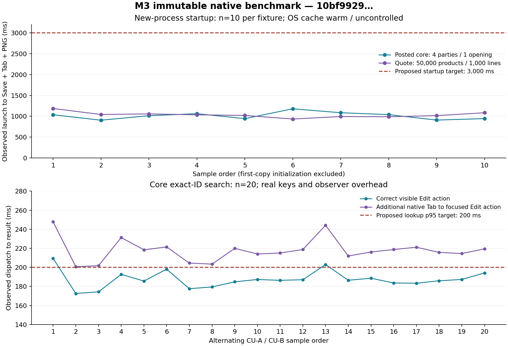

# M3 bounded native performance evidence

M3's bounded startup and initial memory measurements are below the proposed targets, but both observed core lookup boundaries miss 200 ms at p95. The complete quotation workflow still misses the strict global heartbeat, navigation and PDF-busy heartbeat limits. PERF-01/PERF-02 remain partial: a small opening and the quotation fixture do not establish the full accounting reference workload or dedicated reference hardware. M1/M2 reports remain historical evidence and are not substituted for this checkpoint.

## Measurement method

The new observer is `scripts/native-performance-M3.py`. It targets an explicitly hashed executable in a private D-Bus/X11/Xvfb/Openbox session and creates fresh synthetic profiles under ignored `artifacts/performance-m3`. It never builds, flushes OS caches or operates on ordinary desktop/business profiles. The existing `scripts/native-performance-M2.py` remains unchanged and runs separately against the same M3 executable for the complete 50,000-product/1,000-line quotation workflow.

Startup begins before process dispatch and ends after the owned window maps, a visible usable quotation Save control is accessible, a real XTest Tab changes native focus and PNG capture completes. AT-SPI discovery/polling and screenshot overhead are included. One first process on each fresh SQLite backup is recorded separately, including initialization/migration where applicable. Ten subsequent samples each start a new process on the initialized profile. OS pages are warm or uncontrolled; this is process-cold startup, without physical/cache-cold evidence. Hashing and copying also warm file pages.

Core lookup uses the real staged native list. Search control/list discovery and positioning focus occur before timing. Twenty samples alternate exact party IDs through real XTest Ctrl+A and ASCII keys. The first endpoint requires one filtered row, its correct current ID label and a visible sensitive Edit action. A second endpoint includes native Tab navigation to focus that action. GTK rejects the observer's component focus request, so actual keyboard navigation is used. Dispatch, debounce, GTK rendering, five-millisecond AT-SPI polling and the second endpoint's extra focus navigation are included; these are observed boundaries, not isolated UI execution time. Exact-ID queries on four parties do not certify broad 10,000-party lookup.

Before preview timing, changing the source reason invalidates the old successful verification. Real Space on the already-discovered focused Preview control starts the observation; an enabled Post control ends it. Post timing starts at real Space on its focused control and ends when a read-only SQLite query observes exactly one durable opening and one journal. Each is one observation with observer overhead, not a p95 estimate. Native smoke durations which include its 400-ms sequencing poll are not used as UI latency.

The opt-in native `PhaseMonitor` uses a 16-ms GTK timer. Preview runs from command dispatch through completed UI result rendering; posting runs from dispatch through the first timer observation of persistence-busy release after observing busy. SQLite commitment is checked independently. Every gap, tick count, result and endpoint is retained. A phase which finishes before busy can be observed, has no ticks or lacks a completed result is unmeasurable rather than a passing heartbeat. Earlier mismatch/staging previews are retained individually and excluded from the observer's final preview/post boundaries.

Startup application RSS is polled every 10 ms from `/proc/PID/status`; steady RSS is recorded after 500 ms idle. Kernel VmHWM records peak application resident memory. After-core-workflow and after-full-quotation-workflow memory are separate points. Xvfb, accessibility services and helpers are excluded. The proposed initial budget is 250 MB; later-workflow RSS has a different boundary.

Quantiles use nearest rank, n=10 per startup dataset and n=20 per core lookup. For those sample sizes p99 equals worst and does not reliably estimate the population tail. After first-copy initialization, every startup sample must preserve exact persisted payload and generation; staged search and preview must preserve their durable baseline. Hashes, profile shapes, original/copied generations and source/binary hashes before/after are retained in JSON.

## Synthetic fixtures

| Fixture | Actual source and scope |
|---|---|
| Native core, staged then posted | Fresh guided setup and native editable forms: 21 balance rows, 4 parties, 2 units, 1 item with 1 pack ratio, 2 warehouses, 1 cash, 1 bank, 2 AR and 2 AP rows, zero advance rows, 2 cheques, 2 stock rows and 1 GRNI row. `import_source:null`. Final raw state has 1 company, 1 period, 26 accounts, 1 setup, 1 opening, 1 journal, 1 request and 30 audit rows. Preview verified twelve zero controls; raw balances independently sum to 1,251/1,251 IRR, stock value 300 IRR and GRNI 50 IRR. Counts are confirmed from the final manifest/raw state rather than inferred from CSV. |
| Native CSV fixture | Separate strict import/export and independent-reconstruction tests use the declared 35-row CSV. This is not the performance observer's native-forms source, and those tests are not native CSV-import latency proof. |
| Quotation scale | Read-only backup of `/workspace/sarv-evidence/native-before-current`: 50,000 products and 1,000 draft rows. The unchanged complete native scale harness independently creates its synthetic fixture and must verify the entire quote and exact 100,802,501-IRR total on the M3 executable. |

## Executor and limits

The shared executor exposes five AMD EPYC 9V74 virtual CPUs under KVM; `cpu.max=400000 100000` limits the cgroup to four CPU equivalents. It runs Debian 13.6, with a 16-GiB cgroup memory limit and an overlay filesystem. Runtime: Rust 1.99.0, GTK 4.22.5, stable libadwaita 1.9.4; private X11/Cairo/Xvfb/Openbox at 1450×1050, scale 1. Raw CPU/OS/memory/cgroup/filesystem/runtime details accompany JSON. SQLite uses WAL, synchronous FULL and a three-second busy timeout. This is not a physical SSD or dedicated four-core/8-GB reference-desktop declaration. Heavy root builds/tests completed before timing; other agents' native/independent probes and shared-executor scheduling were not fully controlled. Repeated and full-scale performance runs were sequential; the later regression batch waited until they finished.

No OS-cache-cold, full five-year/100,000-document/one-million-journal-line/10,000-party, 10,000-row staged-import, Windows, Wayland, packaged distribution, physical-print or production workload claim follows. A heartbeat is a timer/scheduling proxy, not a CPU profiler's attribution of one continuous blocking function. Functional success does not accept missed strict budgets: 50-ms main-loop gap, 150-ms navigation and proposed 200-ms lookup remain unchanged.

## Final measurements and provenance

Final immutable executable: `/workspace/sarv-evidence/bin/sarv-M3-final`, SHA-256 `10bf9929d00cdf98280a51a2c12860ec39939cdbe8620eb2d827b2bb1de6cee1`. Repeated measurement began at 2026-10-07T19:36:43Z with source HEAD `90b7297c2d3e333702db82206c175ddb9281f29c` plus the integrating M3 changes. The [freeze manifest](../docs/assets/accounting-m3/checks/freeze4-manifest.json) records source aggregate `0afa43f953def0394b3eb31f996918df13fd96ee8d6ac7bb4025d393956df9df`.

The observer's source digest `97ef53a3f4931e6c472de2d3cd09c36aab901bb76cf607a96622036e90a8bae9` stayed identical before/after, as did the binary hash. This is the same file set/content with a different ordering: the observer sorts `pathlib.Path` components, while the freeze manifest sorts complete relative UTF-8 strings. Both concatenate path, NUL, raw bytes, NUL. [Ordered-file provenance](../docs/assets/accounting-m3/performance/source-provenance.json) retains both orders, per-file digests and a post-run recomputation matching the freeze aggregate. No source change is inferred from these two aggregate encodings.

[Repeated raw JSON](../docs/assets/accounting-m3/performance/performance.json), [scale JSON](../docs/assets/accounting-m3/performance/scale-performance.json) and [full native scale verification](../docs/assets/accounting-m3/performance/native-scale-verification.json) retain sample-level data and limits. Original raw directories are `artifacts/performance-m3/final-repeated` and `artifacts/performance-m3/final-scale`; development pilots 1–5 are excluded.

| Observed operation, ms | n | p50 | p95 | p99 / worst | Result at this boundary |
|---|---:|---:|---:|---:|---|
| Posted core new-process startup; OS warm/uncontrolled | 10 | 1,013.891 | 1,179.035 | 1,179.035 | Below 3,000-ms proposed startup target on this fixture |
| 50,000-product/1,000-line quote new-process startup; OS warm/uncontrolled | 10 | 1,019.100 | 1,185.902 | 1,185.902 | Below 3,000-ms proposed startup target on this fixture |
| Core exact-ID keys to correct visible Edit action | 20 | 186.409 | 202.976 | 209.403 | **Misses 200-ms p95** |
| Same lookup plus native Tab to focused usable Edit action | 20 | 216.139 | 244.176 | 247.821 | **Misses 200-ms p95**; extra focus navigation included |

The first process on a fresh backup took 1,005.943 ms for core and 1,516.210 ms for quote. Core was already schema 4/generation 2; quote's original schema 1/generation 7 copy initialized to schema 4/generation 8. These single first-copy observations are excluded from repeated quantiles and do not establish OS-cache-cold launch. The startup endpoint proves editor Save and keyboard interaction, while deferred row/review work may still be pending; it does not prove every 1,000-row widget/review is ready.



| Application resident memory | Boundary | Steady p50, KiB (MiB) | Steady p95/worst, KiB (MiB) | Kernel HWM p95/worst, KiB (MiB) |
|---|---|---:|---:|---:|
| Posted core | n=10 startup +500-ms idle | 89,612 (87.51) | 90,540 (88.42) | 96,868 (94.60) |
| Quote scale | n=10 startup +500-ms idle | 171,476 (167.46) | 171,620 (167.60) | 171,620 (167.60) |
| Core after search/preview/durable posting | n=1 separate workflow point | 130,900 (127.83) | No quantile claim | 130,900 (127.83) |
| Complete native quotation import/editor/picker/composer/PDF workflow | n=1 separate process | 260,016 (253.92) | No quantile claim | 310,660 (303.38) |

Initial RSS is below 250 MB on these fixtures. Full quotation workflow RSS exceeds that numerical threshold at a different boundary; it is not an initial-RSS measurement or evidence of a leak. No global memory acceptance follows.

Core's initialized/final generation 2 payload SHA is `06c42ff8653dbd0dad303c7a7a3b3b4cc20d8d76e5cc396012cf9d0d712d5e90`. Quote's initialized/final generation 8 payload SHA is `2b0eb841ac7440543fe5e857b3bb58c24fc9a9e63acb4132d78cb6b952ebe89a`. The observer asserted exact equality after every startup, and preserved staged durable state during search/preview. Original quote schema 1/generation 7 payload SHA remains `3b75e786f3daef592d1521032470a08797d818f796e19eb28a40e79e07caf2f0`; original profiles were not mutated. Only the fresh synthetic workflow's deliberate post changed financial state.

| Preview/post measurement | n | Actual ms | Limit / interpretation |
|---|---:|---:|---|
| Preview Space to newly enabled Post | 1 | 67.275 | Accessibility observer boundary; no p95 or invoice-posting claim |
| Post Space to durable SQLite opening/journal | 1 | 6.350 | Durability endpoint precedes complete UI refresh; no p95 claim |
| Native preview dispatch through rendered result | 1 | 52.233 elapsed; 16.118 maximum gap; 3 ticks | Measured phase below strict 50-ms heartbeat proxy |
| Native post dispatch through observed persistence-busy release | 1 | 55.434 elapsed; 37.577 maximum gap; 2 ticks | Measured phase below strict 50-ms heartbeat proxy |

These phase results are `verified` and `worker_finished` with actual timer ticks. Earlier mismatch/verified previews remain separate records. Small opening heartbeat observations cannot accept all heavy flows or the full reference fixture.

## Complete quotation workflow: functional success and strict misses

The unchanged M2 harness passed 15 functional checks on this M3 executable, including all 500 catalogue pages, all ten quote editor pages, retained/reopened 1,000 canonical lines, exact 100,802,501 IRR, save conflict/input preservation, cold/warm bounded picker and composer, native keyboard/navigation during PDF work and generated PDF. Its 20-ms global heartbeat includes setup, pagination and probe screenshot work. The functional probe's older 250-ms PDF guard is not the strict 50-ms acceptance target.

| Strict measured scale boundary | Actual ms | Budget ms | Result |
|---|---:|---:|---|
| Global maximum main-loop timer gap | 478.029 | 50 | **Miss** |
| Worst unchanged editor page to usable result | 182.544 | 150 | **Miss**; 17 unchanged clicks in one workflow, no p95 claim |
| Maximum heartbeat gap while PDF busy | 133.855 | 50 | **Miss** |

The 1,000-line background PDF completed in 1,685.509 ms; native save dispatch took 5.579 ms. These are individual durations, not repeated quantiles. Timer/scheduling gaps and observer work cannot attribute a continuous block to one function, but no strict miss is waived. Product application logs contain zero WARNING/CRITICAL/width-overflow matches. External AT-SPI emits stale-cache `GetItems` warnings as owned processes disappear between restarts; those observer teardown warnings are separate from product logs.

Reproduction uses new directories:

```sh
source /workspace/sarv-environment/activate.sh
dbus-run-session -- /usr/bin/python3 scripts/native-performance-M3.py \
  --binary /workspace/sarv-evidence/bin/sarv-M3-final \
  --expect-sha 10bf9929d00cdf98280a51a2c12860ec39939cdbe8620eb2d827b2bb1de6cee1 \
  --samples 10 --search-samples 20 \
  --output /workspace/sarv-quote/artifacts/performance-m3/reproduce-repeated
dbus-run-session -- /usr/bin/python3 scripts/native-performance-M2.py \
  --binary /workspace/sarv-evidence/bin/sarv-M3-final \
  --expect-sha 10bf9929d00cdf98280a51a2c12860ec39939cdbe8620eb2d827b2bb1de6cee1 \
  --output /workspace/sarv-quote/artifacts/performance-m3/reproduce-scale
```
